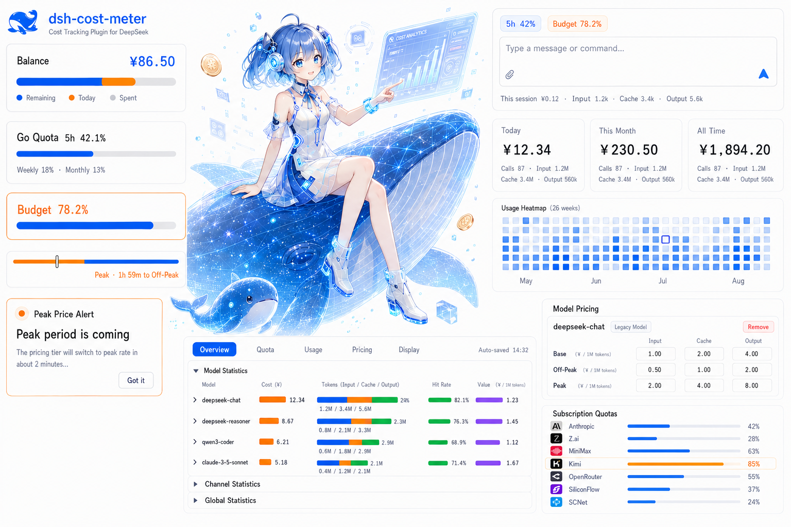
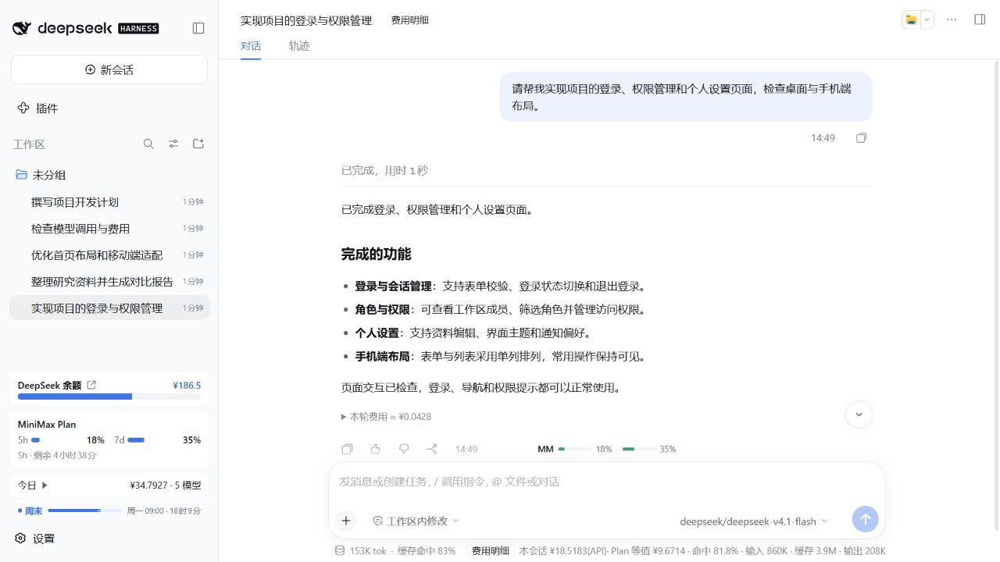
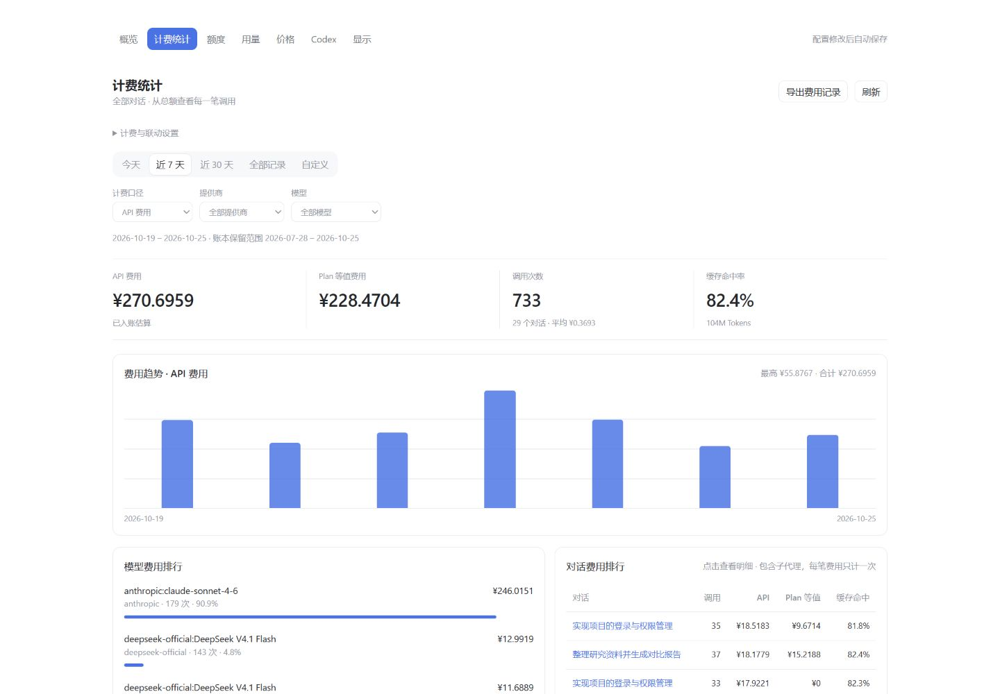
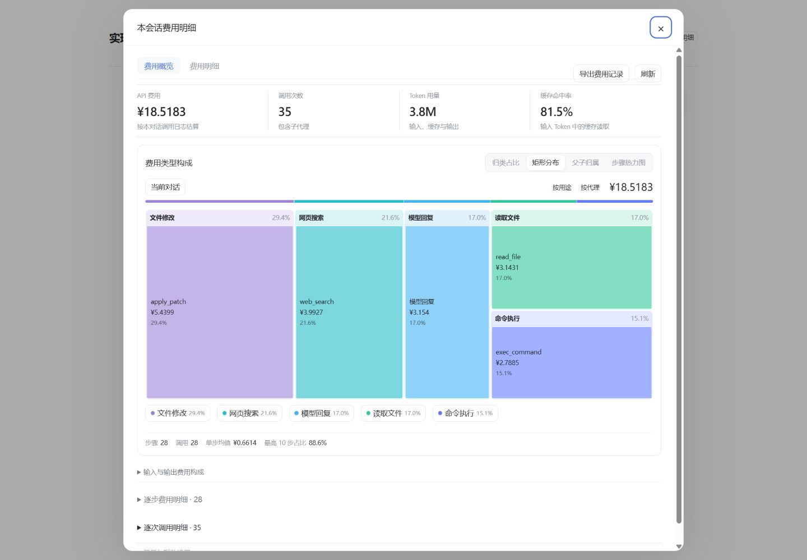
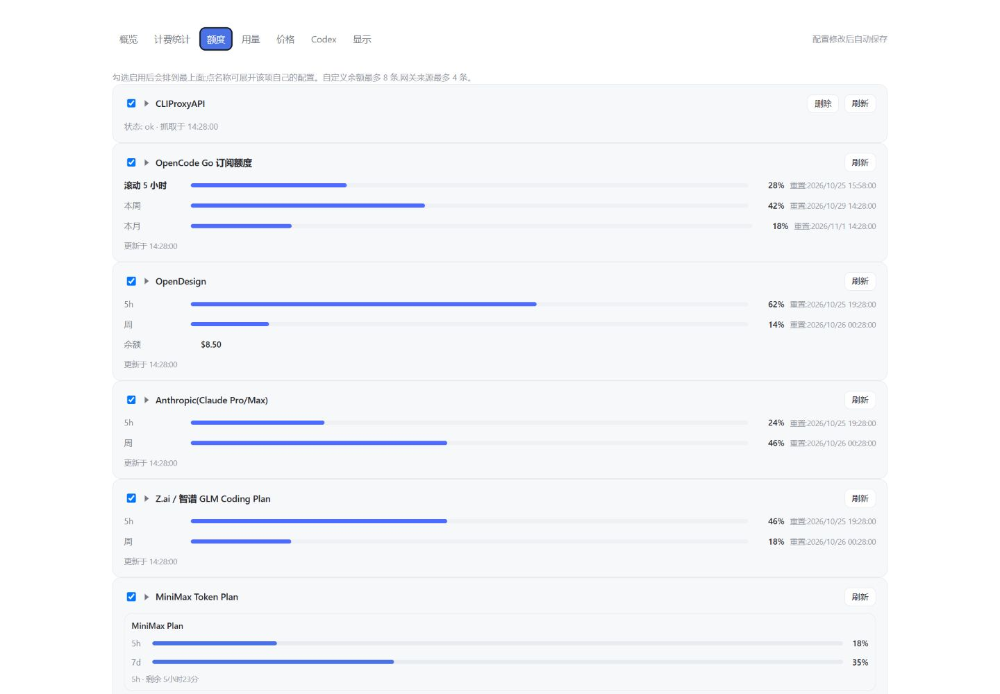
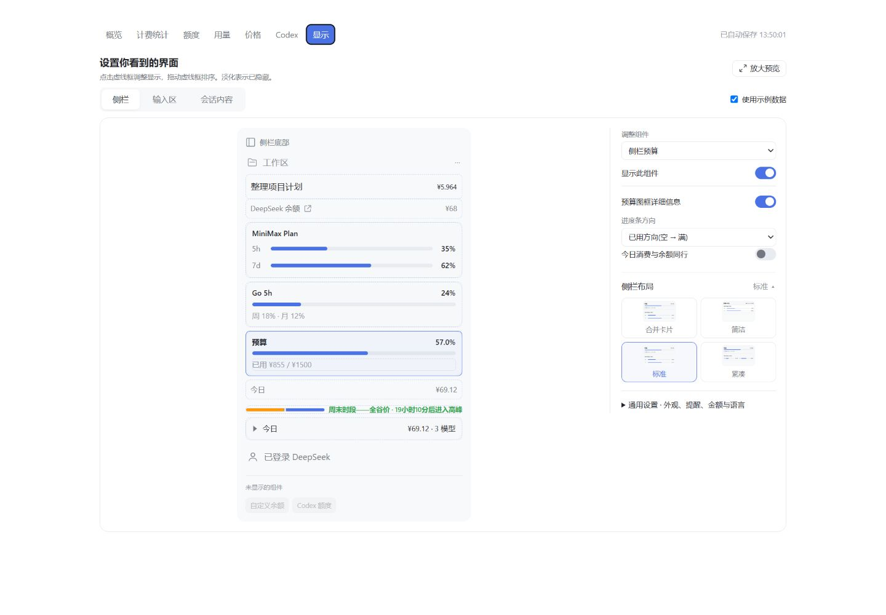

<h1 align="center">dsh-cost-meter</h1>

<p align="center">Cost tracking and subscription quotas for DeepSeek Harness</p>

<p align="center">
  <a href="https://github.com/Han-1413141/dsh-cost-meter/releases/latest"></a>
  <a href="https://www.npmjs.com/package/dsh-cost-meter"></a>
  <a href="https://github.com/Han-1413141/dsh-cost-meter/stargazers"></a>
  <a href="LICENSE"></a>
</p>

<p align="center"><b>English</b> | <a href="README.zh-CN.md">简体中文</a></p>
<p align="center"><a href="#installation">Install</a> · <a href="#feature-overview">Features</a> · <a href="#screenshots--walkthrough">Screenshots</a> · <a href="#documentation">Docs</a> · <a href="#community">Community</a></p>

Track costs and tokens by conversation, model and call. View account balances, subscription quotas and budgets together, with separate API charges and Plan equivalents, multi-provider pricing, peak/off-peak alerts, and configurable sidebar and composer displays.

<p align="center">
  
  <br><sub>Project illustration</sub>
</p>

<picture>
  <source media="(prefers-color-scheme: dark)" srcset="docs/images/conversation-dark.png">
  
</picture>

<p align="center"><sub>Full conversation view in light or dark mode to match your theme. Screenshots use example data.</sub></p>

## Installation

Requires **Node.js ≥ 20, DSH 0.2.0 or later**, and pnpm available to DSH. See [host compatibility](docs/host-compatibility.md).

```sh
dsh plugin --profile web add dsh-cost-meter
```

Restart `dsh web` after installation or updates. **Desktop** uses its bundled CLI and the `desktop` profile; follow the [Desktop guide](docs/install-troubleshooting.md#desktop-安装与更新).

<details>
<summary>Windows installer / pinned version</summary>

The PowerShell installer checks pnpm and Git and uses the `web` profile by default:

```powershell
irm https://raw.githubusercontent.com/Han-1413141/dsh-cost-meter/v1.9.64/install.ps1 | iex
```

Install a pinned Git tag:

```sh
dsh plugin --profile web add github:Han-1413141/dsh-cost-meter#v1.9.64
```

See [installation and updates](docs/install.en.md) for uninstalling or installing without Git.

</details>

Current release **v1.9.64**: [release notes](docs/update-notes-1.9.64.md#english) · [troubleshooting](docs/install-troubleshooting.md)

## Feature overview

- **Conversation and call costs**: Cost entries in the composer, header and each turn. Inspect rates, tokens, recorded inputs and tool results, including parent/subagent cost attribution.
- **Statistics and exports**: Filter by date, provider and model; inspect trends, rankings, cache hit rates and token heatmaps. Export one or all retained conversations, and view local-model API-equivalent costs separately.
- **Quotas and balances**: Codex / ChatGPT, OpenCode Go, MiniMax, Claude, GLM, Kimi, Qianwen, MiMo, OpenDesign and other plans, plus CLIProxyAPI multi-account quotas and custom HTTP balance sources.
- **Multi-provider pricing**: Automatic model matching, editable rates and multipliers, and peak/off-peak tiers. Sync DeepSeek official prices and the OpenRouter catalog; separate API charges from Plan equivalents.
- **Budgets and pricing alerts**: Daily, monthly, cumulative or custom-date budgets. Peak/off-peak schedules and countdowns, with popup and system notifications before a change.
- **Display and history**: Configure sidebar cards, composer entries, quota strips and turn costs. Chinese/English UI, dark themes and mobile layouts; historical imports, retention and storage controls.

See [features and screenshots](docs/features.en.md) for entry points and [model and plan support](docs/model-and-plan-adaptation.en.md) for providers and credentials.

## Screenshots & walkthrough

| Cost trends and model ranking | Conversation cost distribution |
|---|---|
| [](docs/images/statistics.png) | [](docs/images/treemap.png) |

| Subscription quotas and balances | Display settings and interactive preview |
|---|---|
| [](docs/images/quotas.png) | [](docs/images/display.png) |

Select an image for full resolution. [More views: call details, prices, history, dark themes and mobile](docs/features.en.md).

## Documentation

| Topic | Guides |
|---|---|
| Setup and use | [Install, update and uninstall](docs/install.en.md) · [Troubleshooting](docs/install-troubleshooting.md) · [Display settings](docs/display-settings.md) |
| Statistics and billing | [Billing rules](docs/billing.en.md) · [Statistics and details](docs/billing-statistics.md#english) · [Models and plans](docs/model-and-plan-adaptation.en.md) · [Peak schedules](docs/provider-peak-schedules.md) |
| Balances and quotas | [Credentials](docs/balance-credentials.md) · [Custom balances](docs/custom-balance-sources.en.md) · [Gateway quotas](docs/cliproxyapi-quota.md) · [Plan estimates](docs/token-plan-stats.md#english) |
| History and storage | [Retention and cleanup](docs/pricing-history-storage.md) · [Repricing](docs/model-history-repricing.md) · [External usage](docs/external-usage.md) · [Ledger recovery](docs/ledger-lock-recovery.md#english) |
| Development | [Architecture and development](docs/architecture.en.md) · [Contributing](CONTRIBUTING.md) · [Host compatibility](docs/host-compatibility.md) |
| Releases | [Update history](docs/UPDATE-HISTORY.md) · [CHANGELOG](CHANGELOG.md) |

## Community

[Open an issue](https://github.com/Han-1413141/dsh-cost-meter/issues) with plugin and host versions, reproduction steps and relevant logs. The WeChat group is available for usage questions and feature discussions.

<p align="center">
  <a href="docs/community-wechat.png"></a>
</p>

## Contributors

Thanks to everyone who contributes reports, ideas, documentation and code.

<a href="https://github.com/Han-1413141/dsh-cost-meter/graphs/contributors">
  
</a>

## Star History

<a href="https://www.star-history.com/?repos=han-1413141%2Fdsh-cost-meter&type=timeline&legend=bottom-right">
 <picture>
   <source media="(prefers-color-scheme: dark)" srcset="https://api.star-history.com/chart?repos=han-1413141/dsh-cost-meter&type=timeline&theme=dark&legend=bottom-right" />
   <source media="(prefers-color-scheme: light)" srcset="https://api.star-history.com/chart?repos=han-1413141/dsh-cost-meter&type=timeline&legend=bottom-right" />
   
 </picture>
</a>

## License

[MIT](LICENSE) © 2026 dsh-cost-meter contributors
