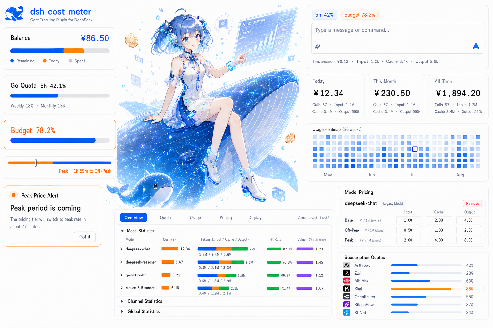

<div align="center">

# dsh-cost-meter

**Session cost tracking for DeepSeek Harness · bilingual UI**

[](https://github.com/Han-1413141/dsh-cost-meter) [](https://www.npmjs.com/package/dsh-cost-meter) [](LICENSE) [](https://github.com/deepseek-ai/deepseek-harness)

**English** | [简体中文](README.zh-CN.md)

[Features](#core-features) · [Install](#install) · [Docs](#docs) · [Community](#community) · [Contributors](#contributors)

</div>


What each conversation cost, how much quota is left this month, what percentage of your subscription plan you have used — DSH does not show any of it. This plugin puts those numbers in front of you.



## Core features

**Per-conversation cost, live.** The cost of the current session appears below the composer or in the session title bar, with input, cache and output token counts. Every model call is billed at the moment it happens, not estimated.

**Subscription quotas and balances in one place.** A single card at the bottom of the sidebar collects the current Coding Plan quota windows (Anthropic, Z.ai, MiniMax, Kimi, OpenRouter, SiliconFlow, Volcano Ark, Xiaomi MiMo, OpenDesign and more), your official account balance, and any custom provider balance. How much is used and when it resets, at a glance.

**Budget and peak-hour alerts.** Set a monthly or custom-range budget and track it with a progress bar. Before DeepSeek switches into peak or off-peak pricing, a popup fires at the lead time you choose — optionally as a system notification, so you still get it with the page in the background.

**Automatic pricing across vendors.** A built-in catalog of 170+ model IDs, with matching that ignores case, spaces and hyphens. Sync prices from the official page in one click when they change. Subscription-plan usage and pay-as-you-go spend are tracked separately and never mixed.

**Bilingual UI and mobile layout.** The interface follows DSH's language automatically, and narrow screens switch to a single-column layout.

The full list is in the [feature reference](docs/features.en.md).

## Install

Requires **Node.js ≥ 20**, **DeepSeek Harness** (0.2.0 and later; adapted for 0.2.1-rc.2), and **pnpm** on the DSH process's PATH.

```sh
# install from npm, always the latest release
dsh plugin --profile web add dsh-cost-meter
```

Restart `dsh web` afterwards.

On Windows you can also use the one-click script (provisions pnpm, detects git):

```powershell
irm https://raw.githubusercontent.com/Han-1413141/dsh-cost-meter/v1.9.39/install.ps1 | iex
```

If the install fails, pnpm reports an error, or the plugin stays disabled after reinstalling, see [installation and updates](docs/install.en.md) and [installation troubleshooting](docs/install-troubleshooting.md).

## Docs

| What you need | Where |
|---|---|
| Every feature and screenshot | [Features and screenshots](docs/features.en.md) |
| How billing and peak pricing work | [Billing rules](docs/billing.en.md) |
| Configuring balances and quotas | [Custom balance](docs/custom-balance-sources.en.md) · [Balance credentials](docs/balance-credentials.md) |
| Adjusting the sidebar and settings | [Display settings](docs/display-settings.md) |
| Supported host versions | [DSH 0.2.1 compatibility](docs/dsh-0.2.1-compatibility.md) |
| Code layout and local setup | [Architecture and development](docs/architecture.en.md) |
| Known issues | [Architecture · Known limitations](docs/architecture.en.md#known-limitations) |
| “Ledger is busy” and the cost widgets are gone | [Ledger lock recovery](docs/ledger-lock-recovery.md#english) |
| What changed in each release | [Update history](docs/UPDATE-HISTORY.md) · [CHANGELOG](CHANGELOG.md) |

Local development:

```sh
git clone https://github.com/Han-1413141/dsh-cost-meter.git
cd <parent directory of the clone>
dsh plugin --profile web add link:./dsh-cost-meter
```

## Community

Questions, ideas, or just curious how others use it — join the WeChat group.

<p align="center">
  <a href="docs/community-wechat.jpg"></a><br />
  <sub>Scan to join · click for full size</sub>
</p>

You can also [open an issue](https://github.com/Han-1413141/dsh-cost-meter/issues). Please read the [contributing guide](CONTRIBUTING.md) first.

## Contributors

Thanks to everyone who reported a problem, suggested an improvement, or sent code. The list is collected by GitHub — click an avatar to see their contributions.

<a href="https://github.com/Han-1413141/dsh-cost-meter/graphs/contributors">
  
</a>

## Star history

<a href="https://www.star-history.com/?repos=han-1413141%2Fdsh-cost-meter&type=timeline&legend=bottom-right">
 <picture>
   <source media="(prefers-color-scheme: dark)" srcset="https://api.star-history.com/chart?repos=han-1413141/dsh-cost-meter&type=timeline&theme=dark&legend=bottom-right" />
   <source media="(prefers-color-scheme: light)" srcset="https://api.star-history.com/chart?repos=han-1413141/dsh-cost-meter&type=timeline&theme=light&legend=bottom-right" />
   
 </picture>
</a>

## License

[MIT](LICENSE) © 2026 dsh-cost-meter contributors
