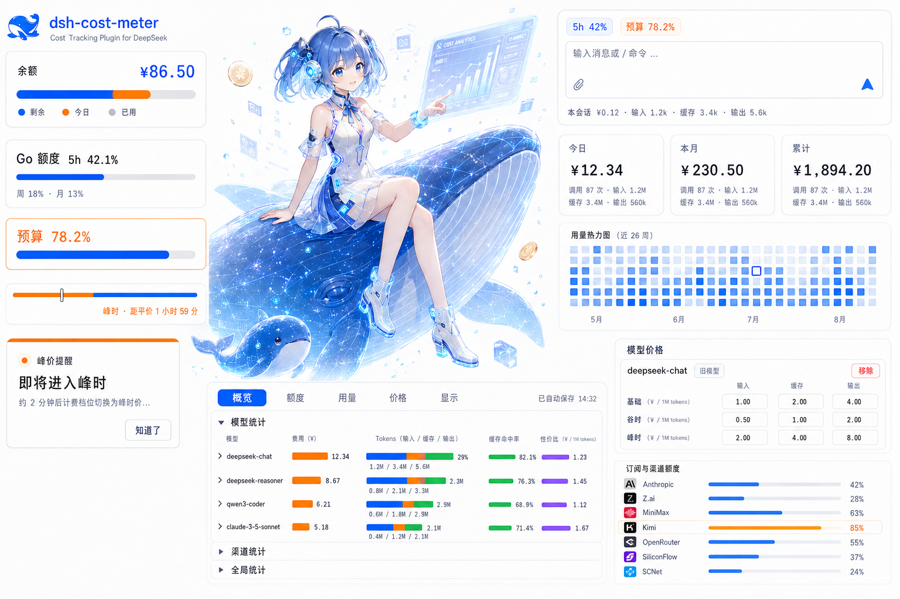
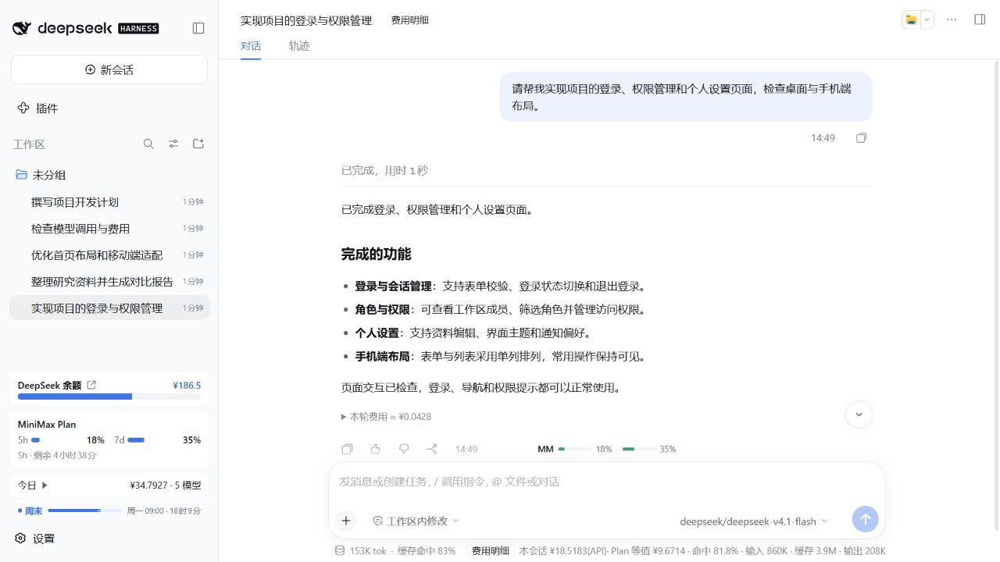
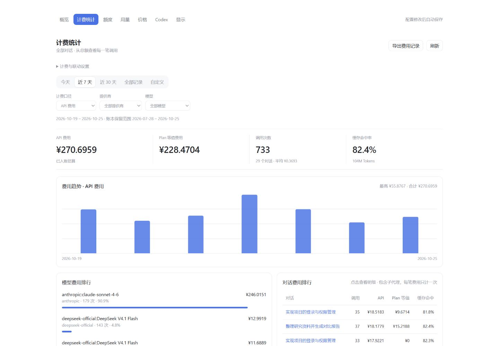
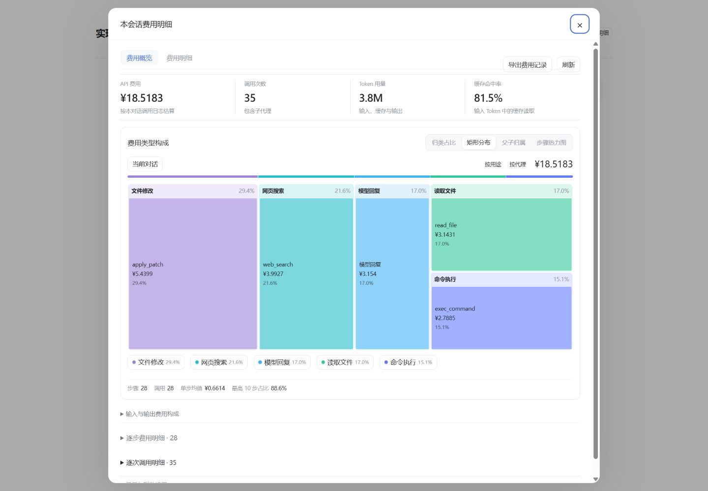
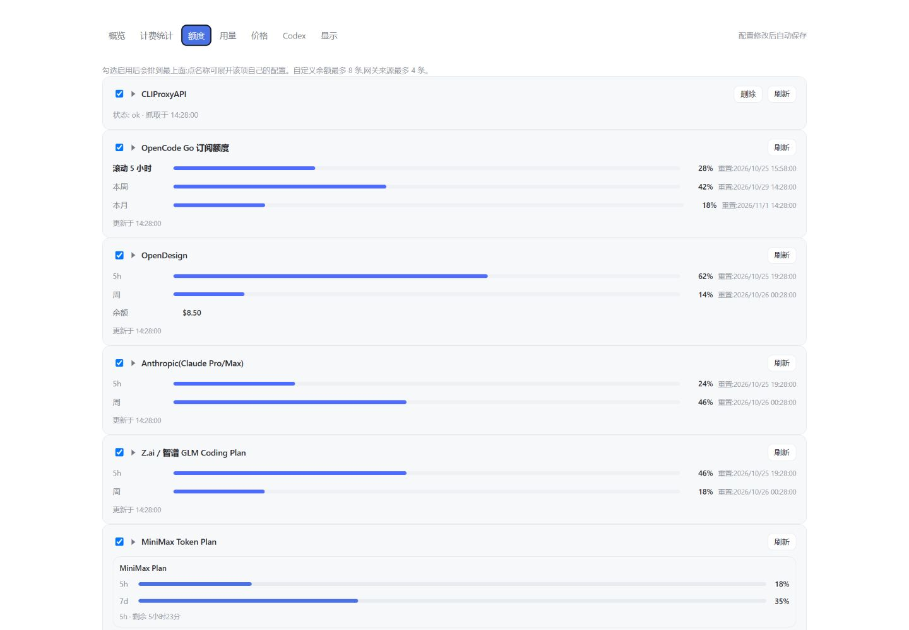
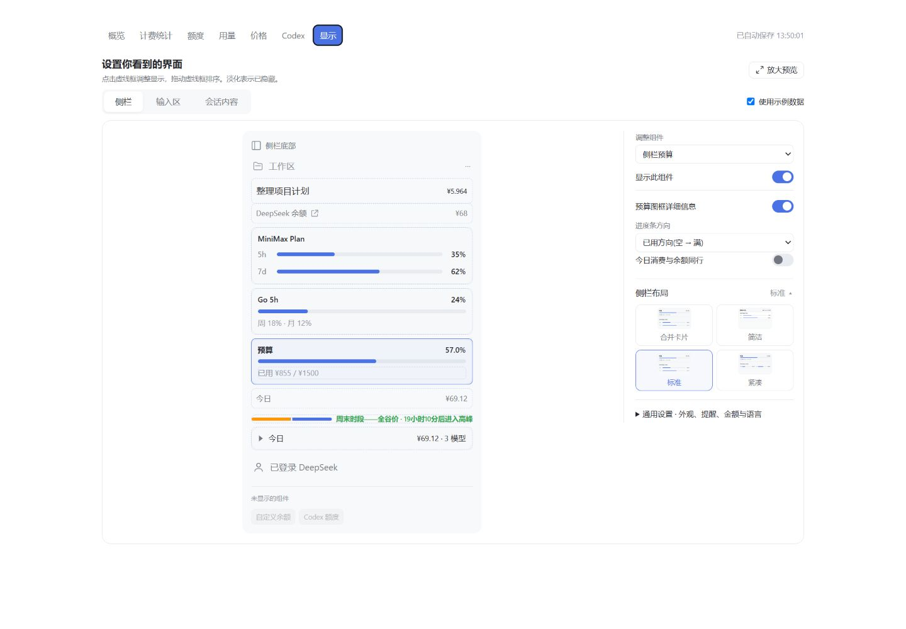

<h1 align="center">dsh-cost-meter</h1>

<p align="center">DeepSeek Harness 费用统计与订阅额度插件</p>

<p align="center">
  <a href="https://github.com/Han-1413141/dsh-cost-meter/releases/latest"></a>
  <a href="https://www.npmjs.com/package/dsh-cost-meter"></a>
  <a href="https://github.com/Han-1413141/dsh-cost-meter/stargazers"></a>
  <a href="LICENSE"></a>
</p>

<p align="center"><a href="README.md">English</a> | <b>简体中文</b></p>
<p align="center"><a href="#安装">安装</a> · <a href="#功能总览">功能</a> · <a href="#图文演示">界面</a> · <a href="#文档">文档</a> · <a href="#交流与反馈">交流</a></p>

按会话、模型和调用查看费用与 Token 用量，集中显示账户余额、套餐额度和预算。支持 API 费用与 Plan 等值费用分开统计、多厂商定价、峰谷提醒，以及侧栏和输入区的独立显示设置。

<p align="center">
  
  <br><sub>项目宣传图</sub>
</p>

<picture>
  <source media="(prefers-color-scheme: dark)" srcset="docs/images/conversation-dark.png">
  
</picture>

<p align="center"><sub>完整会话界面，随主题切换浅色与深色。截图使用示例数据。</sub></p>

## 安装

需要 **Node.js ≥ 20、DSH 0.2.0 或更新版本**，以及 DSH 可用的 pnpm。[宿主兼容记录](docs/host-compatibility.md)

```sh
dsh plugin --profile web add dsh-cost-meter
```

安装或更新后重启 `dsh web`。**Desktop** 使用应用自带 CLI 和 `desktop` Profile，见 [Desktop 安装与更新](docs/install-troubleshooting.md#desktop-安装与更新)。

<details>
<summary>Windows 一键安装 / 固定版本安装</summary>

PowerShell 脚本自动检查 pnpm 和 Git，默认安装到 `web` Profile：

```powershell
irm https://raw.githubusercontent.com/Han-1413141/dsh-cost-meter/v1.9.64/install.ps1 | iex
```

固定 Git tag 安装：

```sh
dsh plugin --profile web add github:Han-1413141/dsh-cost-meter#v1.9.64
```

更新、卸载及无 Git 的安装方法见[安装说明](docs/install.md)。

</details>

当前版本 **v1.9.64**：[更新说明](docs/update-notes-1.9.64.md#中文) · [安装排障](docs/install-troubleshooting.md)

## 功能总览

- **费用明细**：输入区、标题栏和每轮回复显示费用；展开查看单价、Token、输入内容及工具结果。支持父子代理费用归属。
- **费用统计**：按日期、渠道和模型筛选，查看趋势、模型排行、缓存命中率与 Token 热图；导出单个或全部会话记录；单独查看本地模型的 API 等值费用。
- **套餐额度**：支持 Codex / ChatGPT、OpenCode Go、MiniMax、Claude、GLM、Kimi、千问、MiMo、OpenDesign 等；提供 CLIProxyAPI 多账号额度及自定义 HTTP 余额查询。
- **模型定价**：自动匹配模型价格，编辑单价、倍率及峰谷档位；同步 DeepSeek 官方价格和 OpenRouter 目录。API 与 Plan 分开统计。
- **预算提醒**：按日、月、累计或自定义日期设预算；显示峰谷时段和倒计时，支持切换前弹窗与系统通知。
- **显示与历史**：自定义侧栏、输入区、额度横条和每轮费用；支持中英双语、深色主题和手机端。可导入历史、设置保留范围及管理存储。

功能入口和配置见[功能与截图](docs/features.md)；厂商、模型及凭据要求见[适配说明](docs/model-and-plan-adaptation.md)。

## 图文演示

| 费用趋势与模型排行 | 单个会话费用分布 |
|---|---|
| [](docs/images/statistics.png) | [](docs/images/treemap.png) |

| 套餐额度与余额 | 显示设置与交互预览 |
|---|---|
| [](docs/images/quotas.png) | [](docs/images/display.png) |

点击图片查看大图。[更多界面：调用详情、价格、历史、深色与手机端](docs/features.md)

## 文档

| 主题 | 文档 |
|---|---|
| 安装与使用 | [安装、更新、卸载](docs/install.md) · [安装排障](docs/install-troubleshooting.md) · [显示设置](docs/display-settings.md) |
| 统计与计费 | [计费规则](docs/billing.md) · [统计与明细](docs/billing-statistics.md#简体中文) · [模型定价与适配](docs/model-and-plan-adaptation.md) · [峰谷时段](docs/provider-peak-schedules.md) |
| 余额与套餐 | [凭据来源](docs/balance-credentials.md) · [自定义余额](docs/custom-balance-sources.md) · [网关额度](docs/cliproxyapi-quota.md) · [套餐用量估算](docs/token-plan-stats.md) |
| 历史与存储 | [保留与清理](docs/pricing-history-storage.md) · [历史重定价](docs/model-history-repricing.md) · [外部用量](docs/external-usage.md) · [账本恢复](docs/ledger-lock-recovery.md#简体中文) |
| 开发与贡献 | [架构与开发](docs/architecture.md) · [贡献指南](CONTRIBUTING.md) · [宿主兼容](docs/host-compatibility.md) |
| 版本记录 | [更新历史](docs/UPDATE-HISTORY.md) · [CHANGELOG](CHANGELOG.md) |

## 交流与反馈

[提交 issue](https://github.com/Han-1413141/dsh-cost-meter/issues) 时请附插件版本、宿主版本、复现步骤和相关日志。使用交流与功能讨论可加入微信群。

<p align="center">
  <a href="docs/community-wechat.png"></a>
</p>

## 贡献者

感谢社区的问题报告、功能建议、文档和代码贡献。

<a href="https://github.com/Han-1413141/dsh-cost-meter/graphs/contributors">
  
</a>

## Star 增长记录

<a href="https://www.star-history.com/?repos=han-1413141%2Fdsh-cost-meter&type=timeline&legend=bottom-right">
 <picture>
   <source media="(prefers-color-scheme: dark)" srcset="https://api.star-history.com/chart?repos=han-1413141/dsh-cost-meter&type=timeline&theme=dark&legend=bottom-right" />
   <source media="(prefers-color-scheme: light)" srcset="https://api.star-history.com/chart?repos=han-1413141/dsh-cost-meter&type=timeline&legend=bottom-right" />
   
 </picture>
</a>

## License

[MIT](LICENSE) © 2026 dsh-cost-meter contributors
