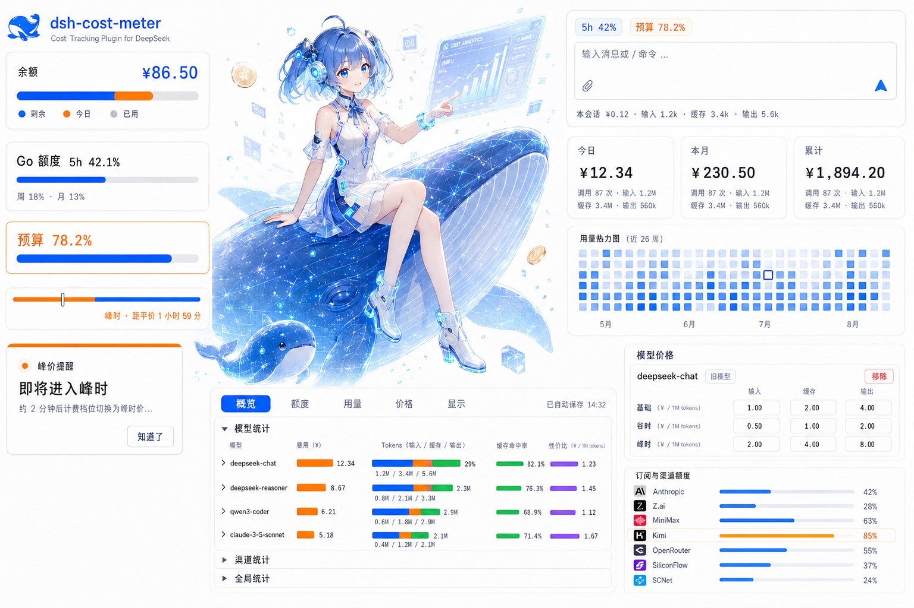

<div align="center">

# dsh-cost-meter

**DeepSeek Harness 会话费用统计插件 · 界面中英双语**

[](https://github.com/Han-1413141/dsh-cost-meter)
[](https://www.npmjs.com/package/dsh-cost-meter)
[](LICENSE)
[](https://github.com/deepseek-ai/deepseek-harness)

[English](README.md) | **简体中文**

[功能](#核心功能) · [安装](#安装) · [文档](#文档) · [交流群](#交流与反馈) · [贡献者](#贡献者)

</div>


每次对话花了多少钱、这个月还剩多少额度、订阅套餐用到了百分之几——这些数字 DSH 本身不显示，本插件把它们放到你眼前。



## 核心功能

**逐会话费用，实时更新。** 输入框下方或会话标题栏显示当前对话的累计费用与输入、缓存、输出 token 数。每一次模型调用按实际发生时刻计价，不是估算。

**订阅额度与账户余额一处看全。** 侧栏底部一张卡片汇总当前的 Coding Plan 额度窗口（Anthropic、Z.ai、MiniMax、Kimi、OpenRouter、SiliconFlow、火山方舟、小米 MiMo、OpenDesign 等十余家）、官方账户余额与自定义 Provider 余额。用完多少、多久重置，一眼看到。

**预算与峰谷提醒。** 设一个月度或自定义区间预算，以进度条跟踪。DeepSeek 进入峰时或谷时之前，按你设定的提前量弹窗，也可以发系统通知——后台跑着也能收到。

**多厂商模型自动计价。** 内置 170+ 模型 ID 价格目录，模型名大小写、空格、连字符不同也能自动匹配。官方价格页改价后，一键同步。订阅套餐与按量付费分开统计，不会混在一起算。

**中英双语与手机端。** 界面跟随 DSH 语言自动切换，手机窄屏自动改成单列布局。

更完整的清单见[功能文档](docs/features.md)。

## 安装

需要 **Node.js ≥ 20**、**DeepSeek Harness**（0.2.0 起支持，适配目标 0.2.1-rc.2），以及 DSH 进程 PATH 中可用的 **pnpm**。

```sh
# 从 npm 安装，始终取最新版
dsh plugin --profile web add dsh-cost-meter
```

装完重启 `dsh web`。

Windows 也可以用一键脚本（自动补齐 pnpm、自动探测 git）：

```powershell
irm https://raw.githubusercontent.com/Han-1413141/dsh-cost-meter/v1.9.39/install.ps1 | iex
```

装不上、pnpm 报错或重装后不加载，见[安装与更新](docs/install.md)和[安装排障](docs/install-troubleshooting.md)。

## 文档

| 想知道什么 | 去哪看 |
|---|---|
| 全部功能与界面截图 | [功能清单与截图](docs/features.md) |
| 怎么计价、峰谷怎么算 | [计费规则](docs/billing.md) |
| 余额、额度怎么配 | [自定义余额](docs/custom-balance-sources.md) · [余额凭据](docs/balance-credentials.md) |
| 侧栏和设置页怎么调 | [显示设置](docs/display-settings.md) |
| 支持哪些宿主版本 | [DSH 0.2.1 兼容声明](docs/dsh-0.2.1-compatibility.md) |
| 代码结构、怎么本地跑 | [架构与开发](docs/architecture.md) |
| 有什么已知问题 | [架构与开发 · 已知限制](docs/architecture.md#已知限制) |
| 启动报 Ledger is busy、费用卡片不见了 | [账本锁恢复](docs/ledger-lock-recovery.md#简体中文) |
| 每个版本改了什么 | [更新历史](docs/UPDATE-HISTORY.md) · [CHANGELOG](CHANGELOG.md) |

本地开发：

```sh
git clone https://github.com/Han-1413141/dsh-cost-meter.git
cd <克隆目录的父目录>
dsh plugin --profile web add link:./dsh-cost-meter
```

## 交流与反馈

有问题、有想法，或者想看看别人怎么用，欢迎进微信群聊。

<p align="center">
  <a href="docs/community-wechat.jpg"></a><br />
  <sub>扫码进群 · 点图看大图</sub>
</p>

也可以直接[提 Issue](https://github.com/Han-1413141/dsh-cost-meter/issues)。提交前请先读[贡献指南](CONTRIBUTING.md)。

## 贡献者

谢谢每一位提过问题、给过建议、写过代码的人。名单由 GitHub 自动汇总，点开头像可看各自的贡献。

<a href="https://github.com/Han-1413141/dsh-cost-meter/graphs/contributors">
  
</a>

## Star 增长记录

<a href="https://www.star-history.com/?repos=han-1413141%2Fdsh-cost-meter&type=timeline&legend=bottom-right">
 <picture>
   <source media="(prefers-color-scheme: dark)" srcset="https://api.star-history.com/chart?repos=han-1413141/dsh-cost-meter&type=timeline&theme=dark&legend=bottom-right" />
   <source media="(prefers-color-scheme: light)" srcset="https://api.star-history.com/chart?repos=han-1413141/dsh-cost-meter&type=timeline&theme=light&legend=bottom-right" />
   
 </picture>
</a>

## License

[MIT](LICENSE) © 2026 dsh-cost-meter contributors
