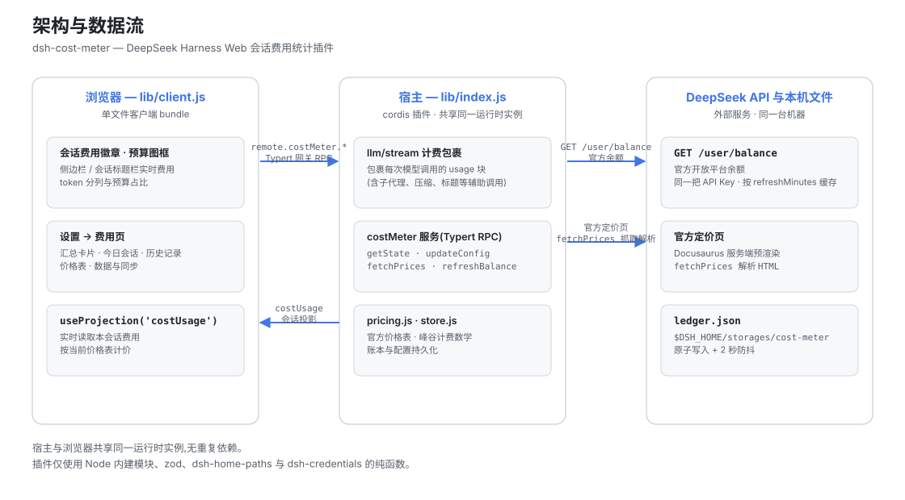

# 架构、开发与已知限制

插件的文件结构、数据通道、本地调试与回归命令，以及已知的限制。

## 架构



```
dsh-cost-meter
├── cordis.patch.yml        # bundle 补丁:向 web profile 插入 cost-meter 行
├── install.ps1             # 一键安装/更新脚本(irm … | iex)
├── .github/workflows/      # CI:install-smoke 一键安装冒烟验证
├── package.json            # dsh.bundle 补丁声明 + dsh.client 浏览器声明
└── lib/
    ├── index.js            # 宿主插件:llm/stream 计费包裹、costUsage 会话投影、
    │                       #   costMeter 服务(手写 typertRemote 绑定)、余额查询
    ├── backfill.js         # 历史账本按模型回填:回放会话日志重建旧账本缺失的
    │                       #   byProviderModel(拼接 zstd frame 扫描 + 逐帧解压)
    ├── pricing.js          # 官方价格表、官方页面 HTML 解析、峰谷计费数学
    ├── store.js            # 账本持久化与配置管理($DSH_HOME/storages/cost-meter)
    ├── typert.host.js      # ./typert 导出:Typert 清单(typert-loader 自动注册)
    └── client.js           # ./client 导出:浏览器单文件 bundle(徽章/图框/设置页)
```

数据通道:

- **本会话费用**:宿主注册 `costUsage` 会话投影(纯 token 桶 + 按模型拆分),浏览器经 `useProjection('costUsage')` 读取并按当前价格表计价;
- **全局账本 / 预算 / 余额 / 配置**:`costMeter/getState | updateConfig | fetchPrices | refreshBalance | resetHistory`,经 Typert 网关 RPC(`remote.costMeter.*`);
- **余额**:调用官方 `GET {baseURL}/user/balance`,复用模型请求的同一把 API Key(凭证服务/环境变量),进程内缓存按 `refreshMinutes` 过期。

插件不导入 cordis/dsh 的 Service/Context 运行时类(仅 Node 内建模块、zod、dsh-home-paths、dsh-credentials 的纯函数),与宿主共享同一运行时实例,无重复依赖风险。

## 开发与验证

```sh
corepack pnpm install                                   # 依赖
node --check lib/index.js && node --check lib/pricing.js \
  && node --check lib/store.js && node --check lib/typert.host.js \
  && node --check lib/client.js                         # 语法检查
node test/verify.mjs                                    # 纯模块验证(解析/计费/账本/配置)
node test/mock-balance.mjs                              # (可选)本地余额接口模拟:3101
dsh --profile web --dump-config                         # 组合树校验
dsh --profile web --port 3099                           # 真机启动(观察启动日志与 UI)
```

## 已知限制

打开费用设置后若侧栏出现加载占位条与「No matching sessions」，请先查看
[无损侧栏搜索恢复说明](session-sidebar-recovery.md)，检查宿主搜索内容，
不要删除会话、账本或浏览器存储。

- 历史按模型回填依赖宿主会话日志仍在盘:日志已被清理的早期调用无法逐模型重建,只能以「未分模型」残差行计入当日合计;
- 官方页面解析依赖当前页面结构;改版后「从官方文档同步价格」会报错,可手动编辑价格表兜底;
- 会话徽章在账本数据不可用时的回退估算按「当前时刻」的价格档位给该会话全部调用定价(含 Plan 类会话):跨峰谷时段的会话在峰时会高估其谷时部分,精确费用以账本为准(账本按每次调用的发起时刻逐笔计价);
- 价格同步会覆盖官方页面列出的同名模型价格,自定义模型条目不受影响;
- 余额查询需要可访问 api.deepseek.com 的网络与有效 API Key;**API Key 只会发往官方域名**(baseURL 指向非官方域名时余额查询拒绝请求,模型请求不受影响);
- OpenCode Go 额度接口为 opencode.ai 官方端点(社区文档);接口结构变化时设置页会显示错误,可在显示设置中关闭该显示;
- Token Plan 统计的「每 1% 额度/满窗」为估算值:各家额度接口只返回百分比且读数存在个位级量化(显示 1% 的真实值可能在 0.5%~1.5%),插件以连续可信段的首尾差分推算以压低量化误差(跨度不足 5 个百分点时标注「读数精度受限」,样本超 7 天回退当前用量折算,窗口边界按小时对齐);服务端百分比统计的是该账号全部用量——同一 Key 在其它机器/CLI 的消耗不在本地账本,估算偏低属预期,仅供跨套餐横向比较;
- Plan/API 双轨分类基于渠道与配置推断,混合订阅/按量使用同一厂商 Key 的场景(如 Kimi 订阅 + PAYG 混用)可在设置中按 provider:model 手动覆盖。
- 安装/更新插件后需重启 `dsh web` 生效。

## English

见 [architecture.en.md](architecture.en.md)。
