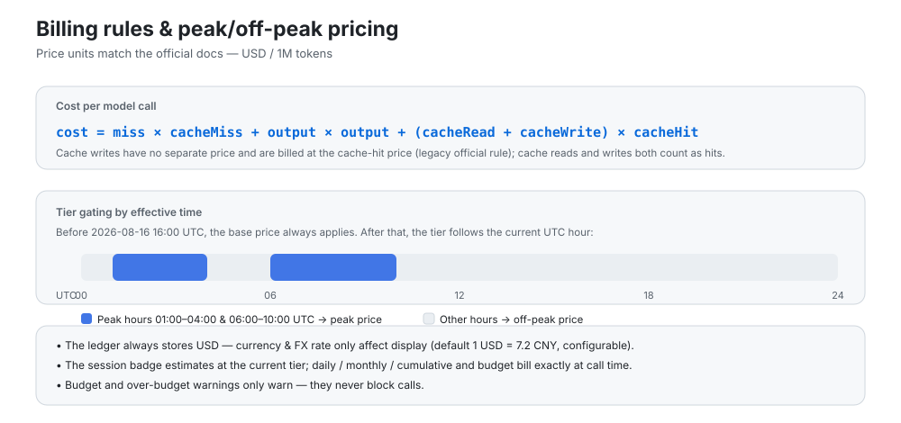

# Billing rules and data storage

Price units, two-tier peak/off-peak billing, historical recalculation, ledger location and credential boundaries.

## Billing rules

- Price units match the official docs: **USD / 1M tokens**;
- cost = cache-missed input × cache-miss + output × output + (cache read + cache write) × cache-hit (cache writes follow the legacy official rule and are billed at the hit price);
- **Pure two-tier peak/off-peak pricing** (the official scheme since 2026-08): peak hours (01:00–04:00, 06:00–10:00 UTC) bill at the peak price and all other hours at the off-peak price (off-peak = half of peak). The base tier equals the off-peak tier, and billing falls back to off-peak when peak/off-peak is disabled; the Settings page shows the live tier (peak / off-peak); the budget/today's cost area shows a peak/off-peak period strip (current/next period with countdown), and the collapsed rail shows a vertical peak/off-peak progress bar;
- **Weekends and Chinese public holidays**: weekends are off-peak all day from 2026-08-23 00:00 Beijing time, including work-shift weekends. Chinese public holidays are also off-peak all day. `peakHolidays` contains Beijing dates in `YYYY-MM-DD` format and defaults to the published 2026 Mid-Autumn and National Day dates after the peak-pricing change; edit the list in Settings → Cost → Peak pricing for future holidays. The period strip labels holidays separately and counts down to the next actual price change. Historical DeepSeek costs are recalculated once from complete session logs; rows without complete logs keep their recorded amounts;
- **Historical billing correctness**: calls before 2026-08-16 16:00 UTC (the peak-era boundary) are billed at the base prices of that time, and later calls at the two-tier scheme;
- The ledger always stores amounts in **USD**; currency and FX rate only affect display (default 1 USD = 7.2 CNY, configurable);
- The session badge is **billed exactly** at the moment each call is made (host-exported per-call cost), just like daily/monthly/cumulative totals and the budget;
- Billing uses usage blocks reported through the host's `llm/stream`, including sub-agents, compression, title generation and other auxiliary calls in isolated LLM services. Child sessions retain their own `sessionId` and do not contribute to the parent badge; background calls without a `sessionId` contribute only to daily/monthly/lifetime totals. Memory or other plugins that call external APIs directly without reporting usage to the host cannot be tracked;
- **Peak/off-peak tiers follow the request-initiation moment**: a streaming call can span the tier boundary hour; attributing by completion time would put a request started minutes earlier into the wrong tier;
- **Peak effective-time anchoring**: the official pricing page no longer lists an effective time, and price sync no longer resets the peak effective moment to "now" — historical recomputes (session projection refolds / per-model backfill) always tier events against the 2026-08-16 16:00 UTC boundary, so peak-hour history is no longer re-costed at half price; ledgers polluted earlier are clamped back automatically on upgrade (idempotent migration);
- **Historical pricing**: changing pricing currency, rates or mappings affects subsequent calls. Saved price versions preserve older details; explicit recalculation requires confirmation and retains original amounts, price versions and a full ledger backup. See the [update notes](update-notes-2026-10-15.md#english).
- **Aligning with official bills**: ① minute-level lag vs live official numbers is expected — the ledger flushes on a 2s debounce, and streams still in flight at shutdown are billed server-side while their usage block is never received (the gap concentrates in cache-hit columns); ② reasoning tokens are reported separately by the API and are **not billed** — the token columns sum five buckets and will never line up with the official three columns, so **reconcile by amount**; ③ with pricing currency set to CNY, entries are recorded directly on the official CNY price list (recommended for CNY-billed accounts); with USD, displayed amounts go through a fixed FX rate and carry a small structural difference (the two lists' per-column ratios are not uniform); ④ granted-balance expiry or reclaim is not consumption: when the day's balance drop is confined to the granted bucket (top-up balance unchanged) and local official-channel usage explains at most a quarter of it, the reconciliation baseline is reset with an informational expiry/reclaim notice instead of a consumption-drift warning;
- Budget and over-budget warnings **only warn — they never block calls**.
- **Plan/API dual-track billing** (issue #64): calls on subscription-style channels (MiniMax, Codex / ChatGPT subscription plugins, etc.) are recorded as catalog-price equivalents only; budget/today-cost/overview cards count the pay-as-you-go (API) channel exclusively.
- **Full-repo security audit fixes**: resolved 3 high-risk findings — ledger writes lost on exit (close/flush ordering), command injection in the release script, panel null-pointer crash on null Go monthly window — plus 30+ medium/low issues including missing hour-bucket entries for routed calls, dead balance-reconciliation warnings, failed custom-balance extraction silently showing $0, and leaked upstream streams on consumer abort; ledger corruption auto-backup, write-failure retry, config-patch atomicity and prototype-chain hardening included. Itemized list: [CHANGELOG.md](../CHANGELOG.md).
- **"Include plan totals" toggle** under the overview cards switches every amount between real-money (API channels only, default) and total equivalent cost (plan subscriptions included); routed calls with a missing provider whose models match third-party catalogs are auto-classified into the matching plan, and legacy per-day residuals without model details count toward the API scope; The Token Plan stats panel in Settings → Usage provides per-1% and full-window token/equivalent-cost estimates plus daily/weekly/monthly usage curves; classification is configurable per vendor and per provider:model.

## Data storage

- Ledger: `$DSH_HOME/storages/cost-meter/ledger.json` (atomic write + 2-second debounce; retained per `historyDays`, up to 200 per-session entries per day);
- **API keys never touch disk**: all credentials (OpenCode Go key, coding-plan keys, Volcano AK/SK) live only in the DSH credential store — neither the ledger file nor anything sent back to the settings page contains plaintext; the settings inputs are write-only and never echo a saved key back;
- Every settings change is **saved instantly and automatically** (600 ms debounce) — no manual save needed;
- Delete the ledger file to reset everything, or use “Clear all history” in Settings;
- Privacy boundary: balance/quota endpoints (official balance and each coding plan) **only get contacted after you explicitly enable the corresponding provider** — no network traffic for disabled ones.

## How official price sync works

`fetchPrices` fetches the official pricing page (Docusaurus server-side pre-rendered; the English page lists USD prices and the Chinese page CNY prices, selected by the "official price currency" setting — currency is auto-detected from the money symbols, and peak windows on the Chinese page are converted from Beijing time to UTC by −8h) and parses:

1. the base price table (transposed layout: first row MODEL + model ids, price labels followed by the prices);
2. the peak/off-peak price table (two rows per model: OFF-PEAK / PEAK);
3. the effective time (“take effect at …”) and the peak-hour windows (“Peak hours are …”).

The parsed result is written into the price table and persisted; if the page structure changes, sync reports an error and keeps the previous prices, with manual editing as a fallback.

## AI price sync

[docs/AI-PRICE-SYNC-PROMPT.en.md](AI-PRICE-SYNC-PROMPT.en.md) (English) and [docs/AI-PRICE-SYNC-PROMPT.md](AI-PRICE-SYNC-PROMPT.md) (中文) provide prompts you can copy straight into any AI:
the AI reads the official pricing on its own → outputs per-model, time-of-day (base/off-peak/peak + effective time) price JSON → you review and apply it (Settings page / RPC / file — pick one). Handy when the official prices change.

## Related

- [Cost statistics](billing-statistics.md): day/week/month views split by turn, model, search and compression
- [Billing currency](billing-currency.md): separate official USD and CNY price lists
- [Peak alert](peak-alert.en.md): the pre-switch popup and system notification
- [简体中文](billing.md)
