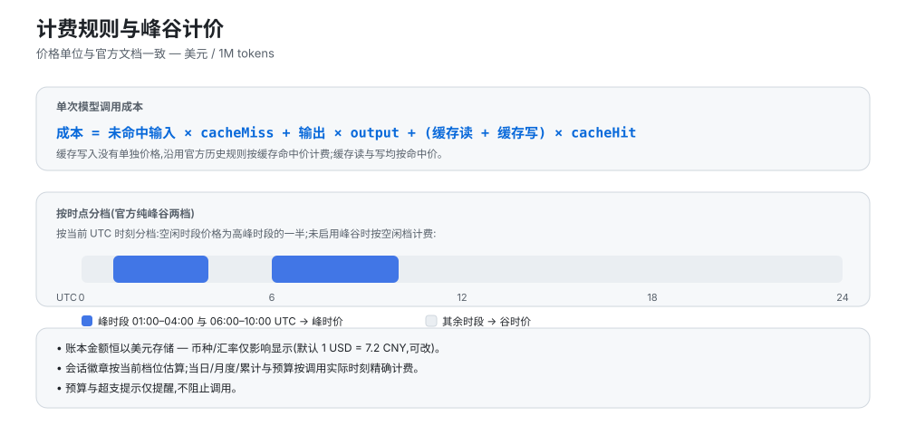

# 计费规则与数据存储

价格单位、峰谷两档计价、历史重算口径、账本位置与凭据边界。

## 计费规则

- 价格单位与官方文档一致:**美元 / 1M tokens**;
- 成本 = 未命中输入 × cache-miss + 输出 × output + (缓存读 + 缓存写) × cache-hit(缓存写沿用官方历史规则按命中价计费);
- **纯峰谷两档计价**(2026-08 起官方方案):峰时段(01:00–04:00、06:00–10:00 UTC)按峰时价,其余按谷时价(谷时价 = 峰时价的一半);基础档与谷时档同价,未启用峰谷时按谷时价计;设置页实时显示当前档位(峰时段/谷时段);预算与今日费用区域显示峰时/平价时段条(当前/下一时段与倒计时),收起态显示竖向峰谷进度条;
- **周末与法定假日全天谷价**：自 2026-08-23 北京时间 00:00 起，周六、周日全天谷价，调休上班的周末也不例外。中国法定假日同样全天谷价。`peakHolidays` 为 `YYYY-MM-DD` 北京日期数组，默认预置 2026 年峰谷规则生效后的中秋和国庆日期；以后可在 设置 → 费用 → 峰谷计价 中修改。时段条单独标注假日并倒计时至下一次实际价格变化。历史 DeepSeek 金额升级时从完整会话日志一次性重算；日志不完整的记录保留原金额;
- **历史计费正确性**:2026-08-16 16:00 UTC(峰谷时代分界)之前的调用按当时的基础价计费,之后的调用按峰谷两档;
- 账本金额恒以**美元**存储,币种/汇率仅影响显示(默认 1 USD = 7.2 CNY,可改);
- 会话徽章与当日/月度/累计、预算一样,按每次调用的**实际时刻精确计费**(宿主导出的逐次成本);
- 计费来源为通过宿主 `llm/stream` 上报的 usage 块，包含隔离 LLM 服务中的子代理、压缩、标题等辅助调用。子会话按自己的 `sessionId` 记录，不并入父会话徽章；无 `sessionId` 的后台调用只计入日/月/累计总额。记忆等插件若直接请求外部 API、未向宿主上报 usage，本插件无法统计该部分消耗；
- **峰谷档位按请求发起时刻判定**:流式调用可能跨峰谷边界整点,以完成时刻归档会把数分钟前发起的请求算进另一个峰位;
- **峰谷生效时刻锚定**:官方价格页已不再标注生效时间,价格同步不再把峰谷生效时刻重置为「同步时刻」——历史重算(会话投影回放 / 按模型回填)一律按 2026-08-16 16:00 UTC 分界判档,峰时历史事件不再被按谷价半价重算;此前被污染的存量账本升级时自动钳制修复(幂等迁移);
- **历史价格保护**：「价格币种」、单价和价格映射的修改只影响后续调用，旧明细使用已保存的价格版本。主动重算前需要确认，并保留原金额、价格版本和完整账本备份。详见[更新说明](update-notes-2026-10-15.md#中文)。
- **官方账单对齐口径**:① 与官方实时数字存在**分钟级时差**属预期——账本 2 秒防抖落盘,关停瞬间仍在途的流会被服务端照常扣费而 usage 块无人接收(缺口集中在缓存命中列);② reasoning tokens 由 API 单独上报且**不计费**,token 列为五桶合计,与官方「三列」天然对不齐,**对账请以金额为准**;③ 「价格币种」设为人民币时按官方 CNY 价目直计入账,与人民币账单币种一致(CNY 计价账号推荐);设为 USD 时显示金额经固定汇率折算,与 CNY 直计存在结构性细差(两套价目比值非均匀);④ 赠送余额到期/回收不算消费:当日余额减少只发生在赠送桶(充值余额不变)、且本地官方渠道费用最多只能解释减量的 1/4 时,重置对账基准并给出「可能是赠送余额到期/回收」的说明,不再按消费偏差告警;
- 预算与超支提示**仅提醒,不阻止调用**。
- **Plan/API 双轨计费**(issue #64):订阅制渠道(MiniMax / Codex、ChatGPT 订阅插件等)的调用金额只记「等值」,预算/今日费用/概览卡片等金额展示仅统计按量计费(API)部分;
- **「含 Plan 总额」开关**:概览页汇总卡片下的快捷开关切换全部金额展示口径——关闭时仅计真金白银(API 渠道),开启后显示含 Plan 等值的总金额;网关路由(provider 缺失)调用的第三方目录模型自动归入对应订阅归类,无模型明细的历史残差计入 API 口径;设置 → 用量 的 Token Plan 统计面板提供每 1% 额度与满窗的 token/等值金额估算与日/周/月曲线;分类可在配置中按厂商或 provider:model 级覆盖。
- **全仓安全审计修复**:账本退出丢写(close/flush 次序)、发版脚本命令注入、面板空指针崩溃(Go 月窗空值)3 项高危,及路由调用小时桶漏记、官方余额对账告警失效、自定义余额提取失败误显 $0、计费流中断泄漏等 30 余项中低危问题全量修复;账本损坏自动备份、写失败重试、配置补丁原子性、原型链与凭据处理加固。逐项清单见 [CHANGELOG.md](../CHANGELOG.md)。

## 数据存储

- 账本:`$DSH_HOME/storages/cost-meter/ledger.json`(原子写入 + 2 秒防抖;按 `historyDays` 保留,每日最多 200 个会话明细);
- **API Key 不落盘**:所有密钥(OpenCode Go Key、各 Coding Plan Key、火山 AK/SK)只存入 DSH 凭据库,账本文件与设置页回传均不含明文;设置页输入框为 write-only,保存后不可回显;
- 所有设置修改**即时自动保存**(600ms 防抖),无需手动保存;
- 删除账本文件即可清零,或使用设置页「清除全部历史」;
- 隐私边界:余额/额度类端点(官方余额与各 Coding Plan)**仅在用户显式启用对应 Provider 时**才会出站请求,未启用不产生任何网络流量。

## 官方价格同步原理

**人民币对账：**美元价格乘以显示汇率与官方人民币价可能不同。「设置 → 费用 → 价格」提供说明和 CNY 选择按钮；选择后等待自动保存，再同步价格。详见[币种选择、同步与结算延迟](billing-currency.md#中文)。

`fetchPrices` 抓取官方定价页(Docusaurus 服务端预渲染;英文页为美元价、中文页为人民币价,由「官方价格币种」设置决定,币种按页面金额符号自动检测,高峰时段中文页按北京时间 −8h 折算为 UTC),解析:

1. 基础价格表(转置布局:首行 MODEL + 模型 id,价格行标签后紧跟价格);
2. 峰谷价格表(每模型两行:OFF-PEAK / PEAK);
3. 生效时间(take effect at …)与峰时段窗口(Peak hours are …)。

解析结果写入价格表并持久化;页面结构变化时同步报错并保留原价格,可手动编辑兜底。

## AI 价格同步

[docs/AI-PRICE-SYNC-PROMPT.md](AI-PRICE-SYNC-PROMPT.md)(中文)与 [docs/AI-PRICE-SYNC-PROMPT.en.md](AI-PRICE-SYNC-PROMPT.en.md)(English) 提供可直接复制给任意 AI 的提示词:
AI 自主读取官方定价 → 输出多模型、分时(基础/谷时/峰时 + 生效时间)价格 JSON → 人工核对后应用(设置页 / RPC / 文件三选一)。适合官方价格变动时自主同步。

## 相关文档

- [计费统计与明细](billing-statistics.md)：日/周/月视图、按轮次/模型/搜索/压缩拆分
- [币种选择与结算](billing-currency.md)：人民币与美元两套官方价格表
- [峰谷切换提醒](peak-alert.md)：切换前的弹窗与系统通知
- [English](billing.en.md)
