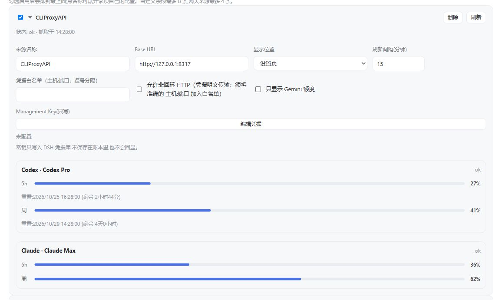

# CLIProxyAPI、Antigravity-Manager 网关额度与 WorkBuddy 积分

## 中文

在“费用 → 额度”添加 CLIProxyAPI 来源，填写网关地址与 Management Key，即可按账号查看 Antigravity、Claude、Codex、Kimi、xAI 的可用额度窗口及重置时间。WorkBuddy 插件来源显示总积分、已用、剩余和套餐周期。

Management Key 存入 DSH 凭据库，账号邮箱在界面脱敏。非本机来源需要配置 `allowedHosts`；局域网 HTTP 还需启用 `allowInsecureHttp`。请求不跟随重定向。

网关查询使用固定管理路径 `/v0/management/auth-files`、`/v0/management/api-call`、`/v0/management/plugins/workbuddy/credits`，只读取额度，不发送模型调用或执行积分消费操作。

勾选“只显示 Gemini 额度”可筛选该来源的 Antigravity 分组。WorkBuddy2API 与 dsh-xdpool 配置见[自定义余额](custom-balance-sources.md)。[CLIProxyAPI 项目](https://github.com/router-for-me/CLIProxyAPI)

### Antigravity-Manager

在“费用 → 额度”选择“添加 Antigravity-Manager”。同一台机器上的默认地址为 `http://127.0.0.1:8045`。使用远程实例时，填写实例地址并把主机及端口加入凭据白名单。保存来源后，展开卡片，点“编辑凭据”填写 Manager 的管理密码。如果 Manager 没有单独设置管理密码，使用它的代理 API Key。启用卡片后即可刷新。

插件通过 `GET /api/accounts` 读取 Manager 已缓存的额度，优先显示分组窗口，旧版响应按模型显示。账号卡片包含额度百分比和上游提供的重置时间，可在侧栏切换账号。停用账号和停用代理的账号会跳过。最多展示 16 个账号，当前账号排在首位。[上游接口实现](https://github.com/lbjlaq/Antigravity-Manager/blob/9b6dfc107df6076f114ad2bb516ba54c69aea784/src-tauri/src/proxy/server.rs)

### Magpie 网关

在“费用 → 额度”选择“添加 Magpie 网关”。如果本机装了 `dsh-magpie-connector`，可以直接留空地址与凭据：插件会借用连接器已配置的线路（取第一条，或与所填地址匹配的那条）和它自己保存的 Key。也可以手填地址，例如 `https://magpie.abworks.cn/v1`，或局域网地址（例如 `http://100.88.187.27:3425`），此时把主机与端口加入凭据白名单，并启用 `allowInsecureHttp`。保存后展开卡片、点“编辑凭据”填入网关 Key。

插件通过 `GET <地址>/magpie/quotas/cards` 读取该 Key 可见的全部卡片，按 `provider` 自动分组：每个 provider 或账号一张卡片，显示各窗口（如 5 小时、周、月）的已用百分比、上游给出的重置时间、套餐名与剩余额度。无需预先把提供商名单写死，网关新增上游后会自动出现；没有窗口数据的卡片标记为未知。最多展示 16 张卡片，账号标识沿用同一套脱敏规则。请求只读且不跟随重定向。

## English

Add a CLIProxyAPI source under Cost → Quotas with the gateway URL and Management Key. Cards show available quota windows and reset times for Antigravity, Claude, Codex, Kimi and xAI accounts. WorkBuddy sources show total, used and remaining credits plus package periods.

The key is stored through DSH credentials, and account emails are masked. Non-loopback sources require `allowedHosts`; LAN HTTP also requires `allowInsecureHttp`. Requests do not follow redirects.

Queries use the fixed management routes `/v0/management/auth-files`, `/v0/management/api-call` and `/v0/management/plugins/workbuddy/credits`. They read quotas without model calls or credit-consumption operations.

“Show Gemini quotas only” filters Antigravity groups within that source. See [custom balances](custom-balance-sources.en.md) for WorkBuddy2API and dsh-xdpool configuration.

### Antigravity-Manager

Under **Cost → Quotas**, select **Add Antigravity-Manager**. The default address is `http://127.0.0.1:8045`. For a remote instance, enter its origin and add its host and port to the credential allowlist. After saving the source, expand its card and use **Edit credential** to enter the Manager admin password. If no separate password is configured, use the Manager proxy API key. Enable the source and refresh.

The plugin reads cached quotas with `GET /api/accounts`. Cards show grouped windows or per-model quotas from older versions, with reset times when available. The sidebar account selector lists up to 16 enabled proxy accounts, starting with the current account. [Upstream implementation](https://github.com/lbjlaq/Antigravity-Manager/blob/9b6dfc107df6076f114ad2bb516ba54c69aea784/src-tauri/src/proxy/server.rs)

### Magpie gateway

Under **Cost → Quotas**, select **Add Magpie gateway**. If `dsh-magpie-connector` is installed, leave both the address and the credential empty: the plugin borrows the connector’s configured line (the first one, or the one matching a given address) and the key it already stores. You can also type an address yourself, such as `https://magpie.abworks.cn/v1`, or a LAN address such as `http://100.88.187.27:3425` also works — add its host and port to the credential allowlist and enable `allowInsecureHttp`. After saving, expand the card and use **Edit credential** to enter the gateway key.

The plugin reads every card the key can see from `GET <address>/magpie/quotas/cards` and groups them by `provider`: one card per provider or account, showing the used percentage of each window (5-hour, weekly, monthly and so on), the upstream reset time, the plan name and remaining credits. No provider list has to be hard-coded — new upstreams appear automatically once the gateway reports them, and cards without window data are marked unknown. Up to 16 cards are shown, with the same account masking rules. Requests are read-only and do not follow redirects.
