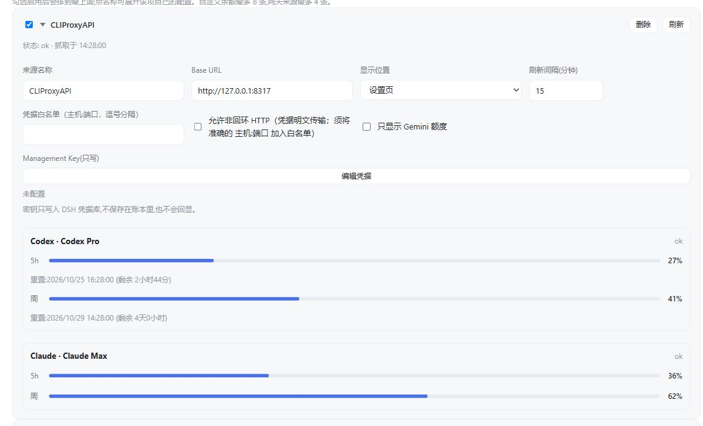

# CLIProxyAPI 网关额度与 WorkBuddy 积分

## 中文

在“费用 → 额度”添加 CLIProxyAPI 来源，填写网关地址与 Management Key，即可按账号查看 Antigravity、Claude、Codex、Kimi、xAI 的可用额度窗口及重置时间。WorkBuddy 插件来源显示总积分、已用、剩余和套餐周期。

Management Key 存入 DSH 凭据库，账号邮箱在界面脱敏。非本机来源需要配置 `allowedHosts`；局域网 HTTP 还需启用 `allowInsecureHttp`。请求不跟随重定向。

网关查询使用固定管理路径 `/v0/management/auth-files`、`/v0/management/api-call`、`/v0/management/plugins/workbuddy/credits`，只读取额度，不发送模型调用或执行积分消费操作。

勾选“只显示 Gemini 额度”可筛选该来源的 Antigravity 分组。WorkBuddy2API 与 dsh-xdpool 配置见[自定义余额](custom-balance-sources.md)。[CLIProxyAPI 项目](https://github.com/router-for-me/CLIProxyAPI)

## English

Add a CLIProxyAPI source under Cost → Quotas with the gateway URL and Management Key. Cards show available quota windows and reset times for Antigravity, Claude, Codex, Kimi and xAI accounts. WorkBuddy sources show total, used and remaining credits plus package periods.

The key is stored through DSH credentials, and account emails are masked. Non-loopback sources require `allowedHosts`; LAN HTTP also requires `allowInsecureHttp`. Requests do not follow redirects.

Queries use the fixed management routes `/v0/management/auth-files`, `/v0/management/api-call` and `/v0/management/plugins/workbuddy/credits`. They read quotas without model calls or credit-consumption operations.

“Show Gemini quotas only” filters Antigravity groups within that source. See [custom balances](custom-balance-sources.en.md) for WorkBuddy2API and dsh-xdpool configuration.
