# Features and screenshots

The complete feature list and UI walkthrough. The README keeps only the core feature summary; details live here.

- [Feature overview](#feature-overview): every feature with its location and description
- [Screenshots](#screenshots): real captures of the sidebar and settings page
- [Bilingual UI](#bilingual-ui): language options and how they apply
- [CLIProxyAPI gateway](cliproxyapi-quota.md): quotas across upstreams in one place
- [简体中文](features.md)

## Feature overview

| Feature | Location | Description |
|---|---|---|
| OpenRouter model prices | Model picker / Settings → Cost → Prices | Hover a model for token rates and update time, or search the full catalog in Settings; automatic foreground refresh, price-change markers in the table and official model links. No API key or inference charges. [Guide](openrouter-prices.md#english) |
| Cost statistics | Below the conversation input / title bar / Settings → Cost → Cost statistics | Day, week, month, all retained and custom periods; API/Plan split, trends, model/conversation rankings and per-call costs. [Guide](billing-statistics.md#english); statistics requires DSH’s asynchronous module loader |
| Per-model cost card | Sidebar / composer dock (optional) | Disabled by default; inline Top-N, Other totals, shares and optional tokens, Today / Last 90 days, remembered expansion and a Top-1 chip. See the [guide](model-cost-card.md#english) |
| Per-conversation cost | Below the composer / session title bar | Live accumulated cost + input/cache/output tokens; the composer footer shows cache hit rate before Input (cache reads / all input, including cache writes); position configurable; Display settings can show only amounts below the composer, with the full line retained on hover |
| Official balance | Sidebar top / Settings page (configurable) | Total / granted / topped-up balance, auto-refresh + manual refresh; optional three-segment progress bar (blue/orange/gray), whose today segment only counts official-channel spend (coding plans / custom providers excluded) |
| Custom provider balance | Sidebar / Settings page (configurable) | Configurable HTTP balance lookup (e.g. LiteLLM); bilingual labels, currency, extract rules (dot path / number / add / subtract / divide — use divide for NewApi-style quota endpoints, see [example](#custom-provider-balance-example-newapi-template)); collapsible panel alongside Coding Plan quotas |
| OpenCode Go quota | Sidebar / Settings / bottom-right dock (configurable) | Rolling-5h / weekly / monthly usage percent and reset times, each window toggleable independently, budget used % can show alongside; key auto-discovered (dedicated ref / official Go route apiKeyEnv / env / opencode login) or entered manually |
| Coding plan quotas | Sidebar / Settings page (per vendor) | Multi-vendor coding-plan quota queries (Anthropic Claude Pro/Max, Z.ai / Zhipu GLM Coding Plan, MiniMax Token Plan, Kimi Code weekly + 5-hour quotas with PAYG balance fallback when no subscription key, OpenRouter credits, SiliconFlow balance, CommandCode 5h/weekly windows + monthly credits balance, Cline Pass 5-hour/weekly/monthly windows, Xiaomi MiMo Token Plan plan/compensation credit windows + period-end reset + balance via console cookie); per-vendor enable switch, key, display position and refresh interval (sidebar card in the same box style as the Go quota; the collapsed rail shows percentages), official endpoints by default, with a [configurable trusted MiniMax origin](minimax-quota-endpoint.md#english); neutral hints when no credentials/subscription; SCNet Token Plan supports [external console snapshots](scnet-official-snapshot.md#english); without a valid snapshot, monthly usage is estimated from the local ledger via the official credits deduction table (no credentials needed) |
| Subscription plugin compatibility | Settings → Cost → Codex / sidebar & quota cards | Detects installed Codex / ChatGPT subscription plugins and classifies their subscription calls as Plan quota instead of pay-as-you-go API spend; new usage is classified at record time, and a one-time dismissible prompt decides whether historical Codex billing is reclassified (idempotent). Explicit plan/API choices are never overridden. [Details](update-notes-1.9.0.md#english) |
| Codex quota display | Settings → Display → Codex / sidebar & quota strip | Reads actual quota windows from `dsh-codex-subscription`, the native DSH pi-ai login, `dsh-chatgpt-sub`, `@eddyskywalker/dsh-chatgpt-subscription`, or `dsh-codex-connect`. Select `auto` (tries these sources in order), `subscription`, `pi-ai`, `chatgpt-sub`, `chatgpt`, or `connect`. Enable quota display and select `dsh-chatgpt-sub` for its bound account's remaining bars and reset times. Weekly-only accounts show no 5h bar. An explicit source uses only that source's current account; billing classification remains separate. |
| SQLite session storage (better-session) | Host integration | Auto-detects the host session backend; with `@morlay/better-session` / `@morlay/session-rdb` (SQLite) storage, historical backfill, legacy import, history repricing, hour-bucket repair, fork cleanup and per-session cost/trajectory/call details keep working. The JSONL path is unchanged; old JSONL and RDB histories are not merged automatically. [Guide](better-session.md) |
| OpenDesign quota | Sidebar / Settings (OpenDesign vendor) | Workspace coding-plan windows from the console API; with a Control Key, a 401/403 from the primary endpoint triggers one conservative `/billing/preflight` Bearer fallback, and window/wallet reads degrade independently. [Troubleshooting](opendesign-billing.md#english) |
| Mobile / dsh-pocket layout | All cost UIs | On screens ≤1023px and dsh-pocket mobile layouts: single-column cards, horizontally scrolling tabs, 36px touch targets, dialogs capped at 90vh with safe-area padding and scrolling wide tables; desktop layout unchanged |
| Quota strip | Above the input box (toggle in Display settings) | One compact chip row for budget used % / the Go main window / each enabled coding-plan usage window (short label + mini progress bar, ≥80% warn, ≥100% over, hover for reset times); click any chip to refresh its data source (budget → state, Go → Go quota, vendor → all its windows); multiple windows of one vendor merge into a single segmented chip; a first-run guide card lets you decide whether to enable it; hides itself when there is no quota data |
| Click to refresh | Sidebar balance/quota boxes | Click the official balance / custom balance / coding-plan box (collapsed rail included) to fetch the latest data immediately; the box pulses while refreshing, failures keep the previous value and surface the reason in the hover tooltip; keyboard Enter/Space also triggers; a one-time guide card appears after the update |
| Simple sidebar display | Settings → Cost → Display | Optional, with a one-time choice after updating. Condenses cards and caps panel height at 38% of the viewport and 320 px, while preserving amounts, quotas, refresh actions and hover details. Turn off to restore your layout. [Guide](sidebar-simple.md#english) |
| Today's cost | Sidebar bottom (above the settings button) | “Today ¥x”, hover for call count and token details |
| Budget box | Sidebar bottom (between the balance row and the settings button) | Rounded-square frame: budget, used %, progress bar, today's cost & share of budget, used/limit; ≥80% warning, ≥100% over-budget |
| Summary cards | Settings page | Today / this month / cumulative cost and call counts |
| External usage | Settings → Cost | [Read-only snapshots](external-usage.md#english) from other processes on the same account; per-source tokens/calls/cost and recent days, plus DSH + external daily/monthly/all-time totals. Fresh external cost for today joins official balance reconciliation. |
| Token usage stats | Settings page (Cost section) | All-time token totals (input/cache/output/calls) + a Codex-style 26-week daily usage heat grid that fills the settings width; hover a cell for that day's detail |
| Token Plan usage stats | Settings page (Usage) | Per enabled coding plan (incl. Go): per-1% quota and full-window token / equivalent-cost estimates for the current windows (sample delta / live ratio), plus daily/weekly/monthly usage curves; plan-channel amounts are equivalent-only and never touch real money (issue #64) |
| Today's sessions | Settings page | Per-session call count, input/cache/output tokens and cost |
| History | Settings page | Per-day totals; retention days configurable (default 180) |
| Pre-install history import | Automatic on first launch | After install/upgrade, the first launch automatically replays all host session logs to import conversations from before the plugin was installed (missing dates are rebuilt whole; existing dates only gain previously unknown sessions; idempotent and never double-counts live metering; costs priced at per-event historical rates); a manual re-run entry remains in Settings |
| Budget settings | Settings page, top | Limit, period (today / month / cumulative / custom date range), used % |
| Price table | Settings page | Per-model off-peak / peak prices (input/output shorthand supported; cache prices derived automatically); fully editable |
| Peak/off-peak hours display | Settings / budget / today | Shows UTC peak hours 01:00–04:00 and 06:00–10:00 with the current tier; weekends and configured Chinese public holidays (Beijing dates) are off-peak all day, with separate labels; expanded view shows a period strip and countdown, collapsed view shows a vertical bar; independently toggleable |
| Peak/off-peak switch popup alert | Global overlay | A full-width bracketed popup appears when the next tier switch is within the configured lead time (default 2 minutes, 1–30), with an alert-colored badge distinguishing entering peak vs off-peak; position selectable (**bottom-right / screen center**), alert type selectable (entering peak / entering off-peak / both), one alert per switch point; optionally **sends a browser (system) notification** (so you still get alerted when the page is backgrounded; requires granting notification permission); configured in the peak pricing panel in Settings, with a **one-click popup preview** (rendered by the real component — copy, position and notifications exactly as they will fire) |
| Official price sync | Settings page | Fetches and parses the official pricing page, applies with one click; the **official price currency** is selectable (USD · English page / CNY · Chinese page) — CNY prices are booked at the display exchange rate and match the official CNY bill when displayed in CNY |
| UI language | Settings → Display settings | Simplified Chinese / English / Follow DSH (auto); switches instantly and auto-saves |
| Hide official balance / hide today's cost | Settings → Display settings | Two independent toggles: when on, the matching UI blocks (sidebar balance row & panels / today's cost row, budget details, overview today card) **are not rendered at all**; token and call-count stats stay visible — safe for screen sharing and screenshots |
| AI price sync | [prompt](AI-PRICE-SYNC-PROMPT.en.md) | DeepSeek official sync; other providers use the verified official price catalog and manual configuration |
| Model & Plan adaptation guide | [adaptation doc](model-and-plan-adaptation.en.md) | Adaptation matrix for per-model billing and the Coding Plan vendors, the auto-matching mechanism and price sources ([中文](model-and-plan-adaptation.md)) |
| Peak/off-peak alert guide | [alert doc](peak-alert.en.md) | Fully illustrated guide to the pre-switch popup and system notification: effect screenshots (EN/中文), settings reference and usage tips ([中文](peak-alert.md)) |
| Token Plan usage stats guide | [panel doc](token-plan-stats.md) | Meaning of the four columns in the per-1% & full-window panel, the end-to-end delta estimation method and precision tags, the scope boundary (dsh-made calls only) and usage curves ([中文](token-plan-stats.md#中文)) |
| OpenRouter passthrough pricing | [pricing doc](openrouter-pricing.md#english) | Token reference prices: offline snapshot, scoped zero-cost backfill, public-catalog refresh, custom-price preservation and failure fallback ([中文](openrouter-pricing.md)) |
| Multi-provider billing | Settings / ledger | OpenAI, Anthropic, Google Gemini, Mistral and other providers with input/output, cache and reasoning-token pricing isolated by provider + model |
| Model-name auto-matching | Settings / ledger | Unknown model ids are matched against the price table: case/spaces/hyphens/dots and bracket annotations (e.g. (go)) are ignored — a normalized-equal or containing name hits (e.g. `gpt5.6 luna(go)`); router providers (opencode/zen etc.) search across all vendors; can be restricted to exact match, and unmatched models can be pinned to a specific entry in Settings |
| Extended price catalog | Settings → Extended price catalog | Built-in reference catalog grouped by vendor and model family (expandable; vendors collapsed by default); mount entries into billing with one click — mounted third-party models live inside the catalog and stay editable; a per-model “Show directly in Cost settings” toggle chooses which models (DeepSeek included) appear directly in the price table |

## Screenshots

> All screenshots were captured on a live DeepSeek Harness instance. They show the Chinese UI by default; the plugin UI itself is bilingual (Simplified Chinese / English) — switch to English under Settings → Cost → Display settings → Language.

### Main page

**Sidebar bottom** (top to bottom: official balance → quota/budget box → settings button):

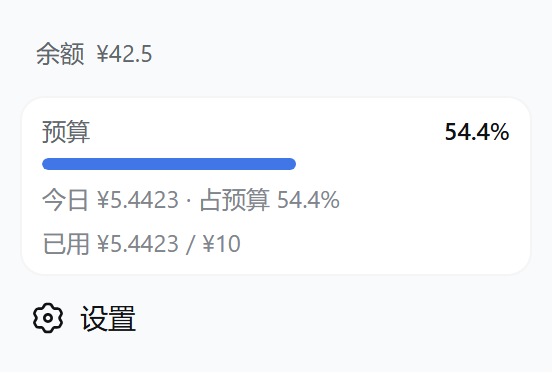

- The balance row shows the official open-platform total balance; hovering reveals the granted/topped-up split; with “Balance progress bar” enabled, both official and custom balances use the same three-segment box (blue = remaining, orange = today, gray = spent);
- With no budget enabled, that spot shows the “Today ¥x” badge.

**Balance progress bar & custom provider settings**:

| Sidebar progress bar + display settings | Custom provider balance panel |
|---|---|
| 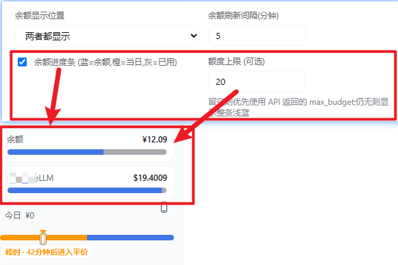 | 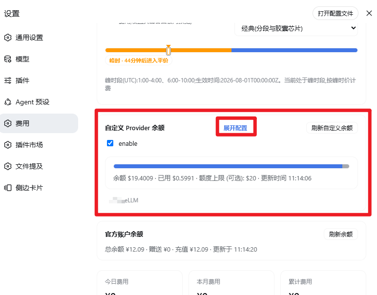 |

- Display settings → global “Balance progress bar” toggle; optional “Budget cap” overrides API `max_budget`;
- Settings → Cost → “Custom provider balance”: expand to edit URL / headers (JSON) / extract (JSON), bilingual names, and currency.

**Quota / budget box — three states** (OpenCode Go quota and the budget each toggle independently in the same rounded style; with both on they **merge into one card** — Go on top, budget below, thin divider, each keeps its own warning colors; the “box details” toggle collapses secondary rows to just label + used % + progress bar):

| Go quota only | Budget only | Merged |
|---|---|---|
| 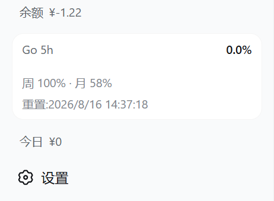 | 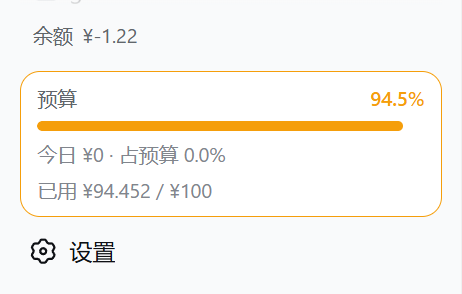 | 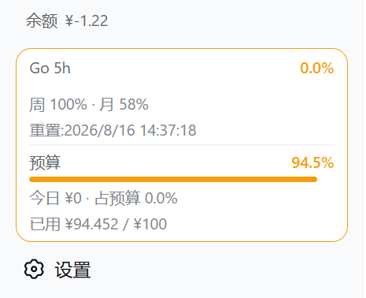 |

- The budget box shows “budget · used % · progress bar · today's cost & share of budget · used/limit”; ≥80% warning, ≥100% over-budget; rail mode narrows to a percentage tile;
- The peak/off-peak hours display shows UTC peak hours 01:00–04:00 and 06:00–10:00 with the current tier; the budget box and today's cost area show a compact one-line period strip — a thin orange/blue track with a marker line on the current period, and text on the right showing the current period plus the countdown to the next switch (refreshed every 30 seconds); no prices are shown; it can be disabled independently in Settings, and the “Peak period strip style” option switches between the Compact and Classic looks; collapsed rail mode shows the same design vertically with a short horizontal label (“Peak / Off-peak”) below — the countdown and full text appear on hover;

**Peak/off-peak period strip & collapsed vertical progress bar**:

| Settings peak panel (notice toggle / style switch / preview) | Settings bottom-right (dock) display & box details |
|---|---|
| 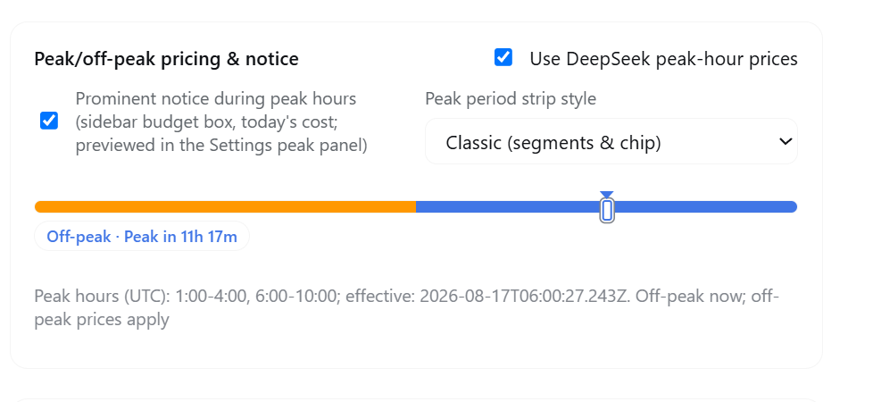 | 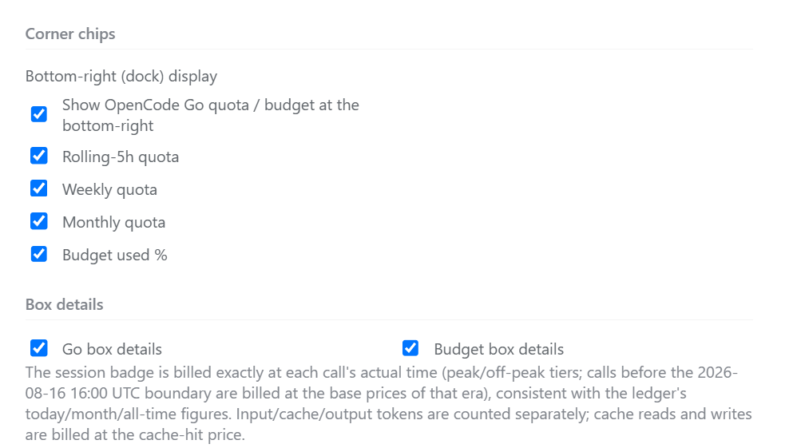 |

Real captures from an actual DSH sidebar of the period strip and collapsed vertical bar (current looks), grouped by UI type (shown during peak hours):

**Expanded** — the budget box / today's cost area shows a one-line period strip:

| Compact | Classic |
|---|---|
| 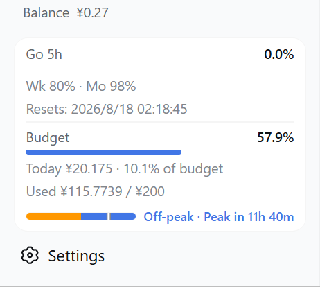 | 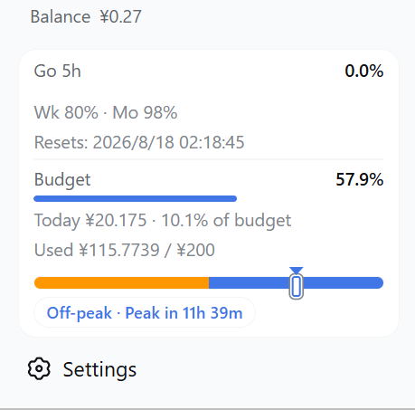 |

- Compact: thin orange/blue track with a marker line on the current period and a short caption, e.g. “Peak · Off-peak in 1h 40m”;
- Classic: same track and marker line with the full caption “Peak · Off-peak in HH:MM:SS” countdown (refreshed every 30 seconds); no prices are shown.

**Collapsed (rail)** — a vertical period bar stacked at the sidebar bottom, centered with the percentage squares:

| Compact | Classic |
|---|---|
| 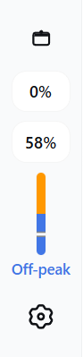 | 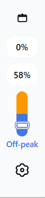 |

- Compact: only the short horizontal label (“Peak / Off-peak”) below the vertical bar;
- Classic: the full caption stacked vertically below the bar, including the countdown to the next switch; in both styles the full text is also available on hover.

- The display follows the `peakNotice` / `peakEnabled` / `peakEffectiveAt` / `peakWindows` gates and uses the configured UTC peak windows;
- Settings → Cost → Peak/off-peak pricing includes an independent “Prominent notice during peak hours” toggle; turning it off hides both the expanded strip and the collapsed vertical bar;
- The first image above is the Settings peak panel (notice toggle, style switch and live preview); see the grouped captures for the strip and collapsed vertical bar; the dock toggles and box-details switches are shown in the second image.

- The Go box shows the main window's used % and progress bar (default rolling 5h; switchable to weekly/monthly in Display settings), with the other two windows and reset times in a row below:

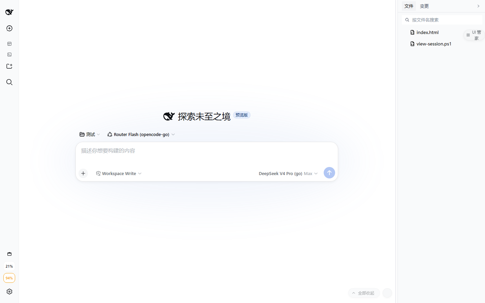

**Bottom-right (dock) quota / budget chips** (enabled in Display settings; four independent toggles: 5h / weekly / monthly quota + budget used %):

| Corner chips in action | Display settings (where the toggles live) |
|---|---|
|  |  |

**Per-conversation cost** (two positions, switchable in Settings):

| Below the composer | Session title bar |
|---|---|
|  | 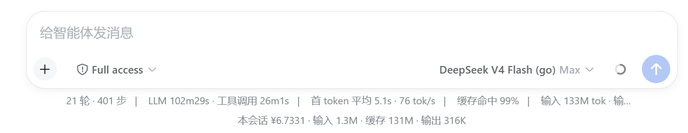 |

> Left: this session ¥5.5939 · input 321K · cache 119M · output 235K; right: title-bar badge “cost ¥6.1606” (real session captures)

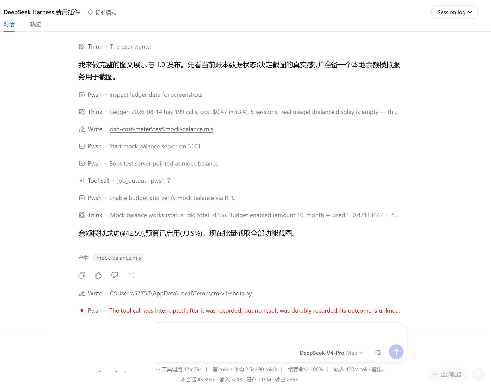

### Settings → Cost

**Overview** (OpenCode Go quota → budget → balance → summary cards → today's sessions → history → display settings → price table → data & sync):

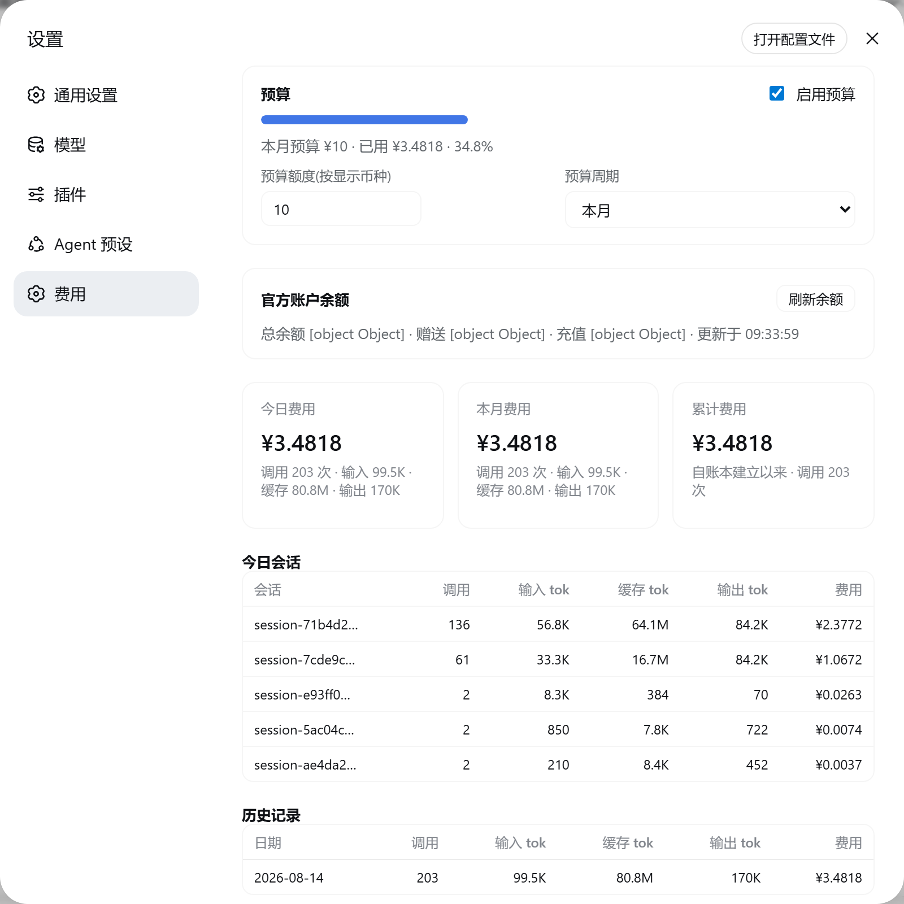

**OpenCode Go quota panel** (very top of the Settings page: three progress bars, main window highlighted, manual refresh; a neutral hint when there is no subscription, one-click disable):

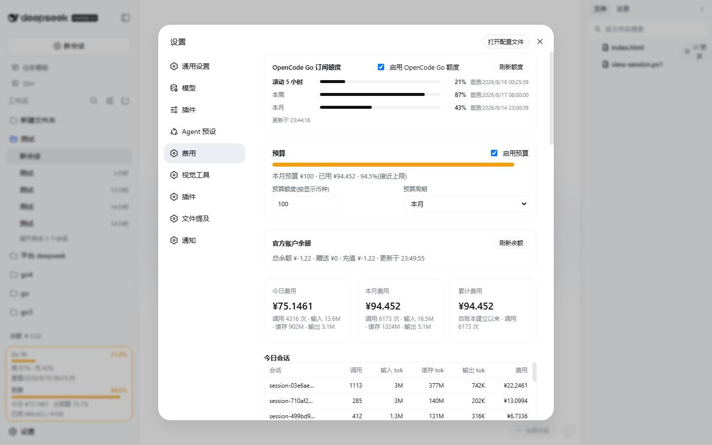

**Budget panel** (including custom date ranges):

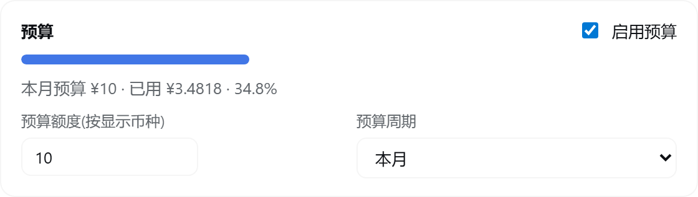

**Balance panel** (total/granted/topped-up + manual refresh):

**Display settings** (Go main window & key, corner chips, box details, …):

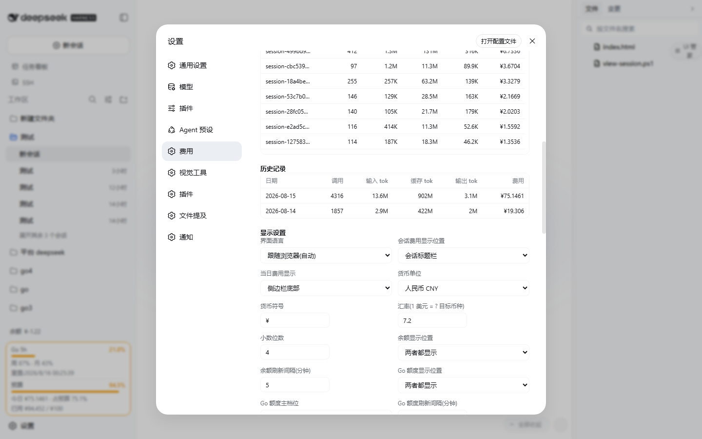

**Summary cards**:

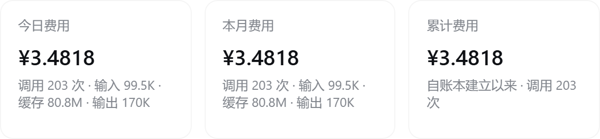

**Token usage stats** (all-time totals + a Codex-style 26-week heat grid filling the settings width; translucent glass cells for unused days):

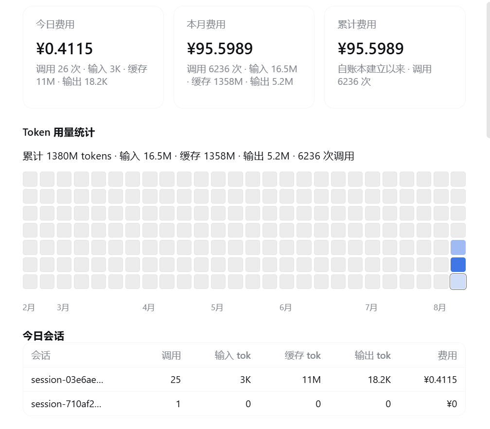

**Today's sessions / history** (input, cache and output tokens in separate columns):

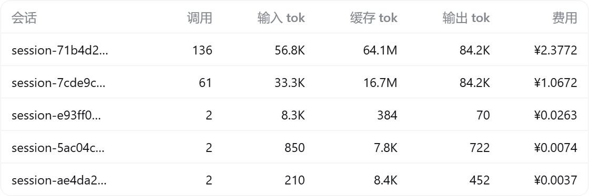 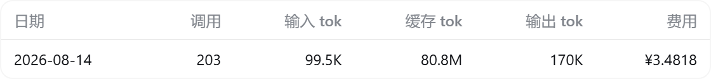

**Price table** (off-peak / peak tiers, with input/output shorthand support, USD / 1M tokens):

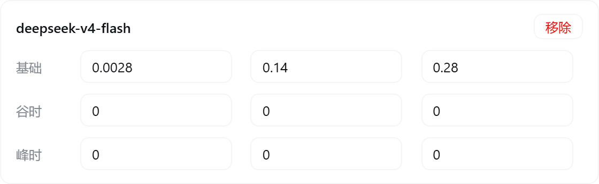

**Data & sync** (instant auto-save of settings + official price sync + clear history):

## Bilingual UI

The plugin UI (session badge, sidebar balance row & budget box, and the entire Settings page) supports **Simplified Chinese** and **English**:

- Language options: **Simplified Chinese** / **English** / **Follow DSH (auto)**;
- Default is “Follow DSH”: auto uses DSH’s active language and updates live, including the statistics screen and Settings sidebar label. Older hosts without the locale face use the saved DSH preference when available, then the browser language (`zh*` → Chinese, otherwise English). Auto stays `auto` in the saved config;
- Switch it under **Settings → Cost → Display settings → Language** — the whole plugin UI updates instantly and auto-saves; the section label in the Settings sidebar switches too (费用 / Cost);
- An explicit Chinese/English plugin choice overrides DSH for both UI and server-generated notices. In auto mode, the Host reads DSH’s saved language preference; without an observable preference it retains the Chinese compatibility fallback. Browser/native-only provisional choices and different clients’ languages cannot be inferred by the Host, so notices may differ in those cases.
